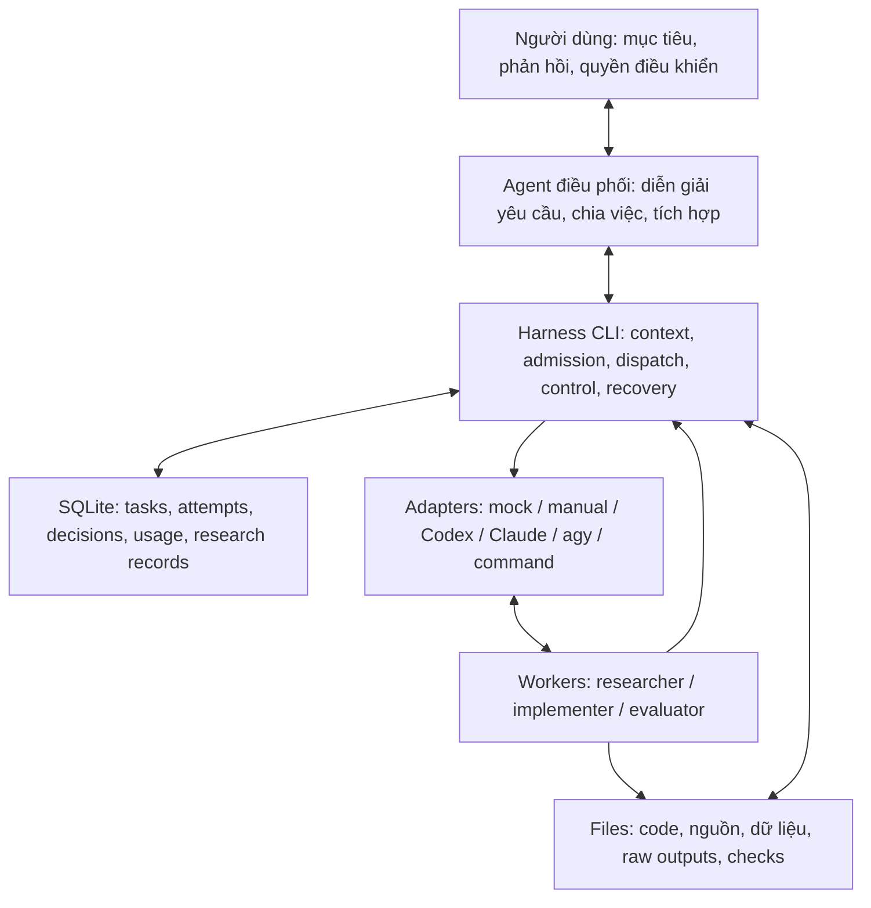

# Research System — Agentic Research Harness

Bộ công cụ giúp người dùng và AI agent thực hiện dự án nghiên cứu AI engineering: đặt câu hỏi, phát triển giả thuyết, suy dẫn toán học, thiết kế thực nghiệm, kiểm chứng và cập nhật hiểu biết, rồi trình bày kết quả. Hệ thống gồm hướng dẫn cho agent, hợp đồng dữ liệu và runtime giữ tiến độ ngoài lịch sử chat.

README này là điểm bắt đầu để hiểu và review domain Research. Toàn bộ lệnh bên dưới chạy từ thư mục `research_system/` chứa file này.

**Dành cho người dùng:** đọc [hướng dẫn sử dụng từng bước](docs/user-guide.md) để chuẩn bị project, kết nối GUI, giao việc qua orchestrator, tùy chỉnh cấu hình, xem tiến độ và xử lý lỗi. Có prompt mẫu và phần terminal tùy chọn.

**Implementation 0.7.0, 29/10/2026:** [kết nối GUI, cấu hình qua hội thoại và inspect](docs/gui-integration.md), [plan và trạng thái](docs/plugin-integration-plan.md), [nghiên cứu xác minh](docs/gui-integration-validation.md) và [nghiệm thu tối thiểu](docs/plugin-acceptance-plan.md). GUI làm orchestrator, shared core giữ managed workers liên backend. Chọn entry skill + bound CLI; không cần runtime ngoài/plugin/MCP. State v4 tương thích; GUI services cần explicit upgrade v5. Live GUI/backend acceptance còn pending.

Đã có project connections cho Codex/Claude/Antigravity, attachment fencing, config preview/CAS/rollback và immutable overlays, async managed handles, native-observed result bridge, bounded reads/redacted logs và terminal inspect. [Evidence 0.7.0](docs/verification/gui-evidence.json) là software checks; generation/fixtures không chứng nhận host loader, model hoặc native permissions. Không có live benchmark trong đợt implementation này.

**Cập nhật 31/10/2026:** orchestrator mặc định Sol High; cố vấn synthesis_planning riêng dùng Astra High; automation mặc định Antigravity Gemini 3.8 Flash High. [Báo cáo sửa đổi và kiểm tra](docs/verification/advisor-routing-2026-10-31.md): 42/42 regressions liên quan pass; full suite 218/231 pass, 13 helper tests bị chặn bởi Python hash drift. Không chạy model/benchmark hoặc tự cập nhật project đang sử dụng.

```powershell
node scripts/harness.mjs inspect-project --config examples/research.json
node scripts/harness.mjs inspect-project --workspace D:\projects\my-research --full
node scripts/harness.mjs inspect-project --workspace D:\projects\my-research --section capabilities --format json
node scripts/harness.mjs connect-gui --workspace D:\projects\my-research --backend codex
node scripts/harness.mjs gui-catalog
```

## Trạng thái hiện tại

Mốc hiện hành: **31/10/2026**, source **0.7.0 / v4 compatible, GUI v5** với sửa phân công/model routing, software preview chờ host/human acceptance. Các con số 204/204, 225/225 và P0 là evidence lịch sử; xem báo cáo 31/10 cho source sau sửa đổi.

| Nội dung | Trạng thái và phạm vi bằng chứng |
|---|---|
| Runtime, workflow nghiên cứu, model routing và planning audit | Đã có implementation và kiểm tra phần mềm cục bộ |
| Software verification hiện hành | **42/42 tests liên quan pass; full suite 218/231 pass**, 13 failures do Python môi trường không khớp hash; **74 JS + 4 Python** syntax checks pass. [Báo cáo 31/10](docs/verification/advisor-routing-2026-10-31.md). Baseline 29/10 giữ riêng: 225/225 và recovery demo |
| Nghiệm thu v1 | Chờ người dùng review theo [V1-01–V1-11](docs/v1-acceptance-plan.md) |
| Backend/model thật | Chưa live-verified; mock pass không xác nhận tương thích hoặc chất lượng của model thật |
| Năng lực tạo tri thức mới, chất lượng nghiên cứu và lợi ích token | Chưa được đo hoặc chứng nhận |
| Benchmarks B01–B03 | Chưa chạy; không là điều kiện bắt buộc để nghiệm thu core |

Evidence được tái tạo bằng `node scripts/verify-v1.mjs`; xem timestamp, Node version và source/evidence hashes trong file JSON. Đây là bằng chứng phần mềm, không phải kết quả chạy nghiên cứu bằng LLM.

Bản 0.3.1 sửa các lỗi state machine và runtime được phát hiện sau review. Đọc [báo cáo sửa lỗi vận hành](docs/operational-review-fixes.md) để xem phạm vi, regression và các giới hạn còn giữ.

Nhánh đầu theo [plan bản 3 lưu trữ](docs/runtime-integration-plan-v3.md) đã có source: [Codex native điều phối](docs/codex-native.md). Dùng App Server stdio trực tiếp, core quản lý worker và ngân sách, không thêm runtime ngoài. Có intent/binding bền vững, native steer/input/checkpoint và các tối ưu context/I/O. [P0 ngày 27/10](docs/verification/p0-2026-10-27/report.md) pass metadata/static với giới hạn; chưa tạo thread/turn hoặc chạy inference. P0 này là evidence lịch sử của source 0.4.0; candidate mới cần preflight đúng scope trước activation. L1/L2 chưa chạy, chưa được duyệt.

[Plan tích hợp bản 4](docs/runtime-integration-plan.md) đã nghiên cứu 18 capabilities và đề xuất workspace/publication, recovery/accounting, parallel writers, session reuse, native subagents và mở backend theo lợi ích thực tế. [Implementation 0.5.0](docs/integration-foundation.md) đã có snapshot workspace, publication journal, parallel-writer admission, accounting baseline, native collect/quota và context cache/pagination. Warm session/native groups/backend sâu tiếp theo còn conditional. Năng lực và tính đúng là ràng buộc; tối ưu chi phí bên trong các ràng buộc đó. Xem [ma trận lợi ích và nguồn](docs/capability-integration-research.md), [capability hiện hành](docs/backend-native-capabilities.md) và [nghiệm thu tối thiểu](docs/acceptance-minimal-protocol.md).

**Research extensions 0.6.0:** [implementation, provisioning, migration và giới hạn](docs/extensions.md). Có scoped retrieval/citation/math/stats/figure/PDF helpers, private controller inputs, receipts và journal publication; profiles/external execution mặc định disabled. Python environment đã provision local, native scope/live acceptance còn pending.

[Khảo sát MCP và skills bên ngoài](docs/external-mcp-skills-research.md) bổ sung shortlist, so sánh native/CLI/MCP, và plan extension policy/lock trước activation. Đây là snapshot nghiên cứu trước implementation; trạng thái thực tế mới hơn ở docs/extensions.md.

[Plan tích hợp chi tiết](docs/external-integration-plan.md) nêu EX0–EX5, package/route cụ thể, native policy, migration/rollback dự kiến và các gate nghiệm thu tối thiểu. Phần EX0–EX5 đã được implementation về software theo docs/extensions.md; native acceptance chưa chạy.

Plan extension phân biệt năng lực Research dùng lặp lại và công cụ theo dự án: đề nghị chuẩn bị retrieval/citation, toán symbolic và phân tích thực nghiệm từ đầu; tái dùng skills/tools của backend và core khi đáp ứng đúng phiên worker. Azure/.NET, biomedical, formal toolchain và nền tảng riêng chọn sau theo nhu cầu. [Catalog discovery](docs/external-capability-catalog.md) không là danh sách cài đặt; baseline extension đã có implementation 0.6.0 và provisioning local; chỉ activate profile sau review scope phù hợp.

## Mục tiêu, phạm vi và đầu ra

Research cần hỗ trợ bốn năng lực:

| Năng lực | Công việc agent cần thực hiện | Artifact để review |
|---|---|---|
| Phát triển hiểu biết mới | Xác định bất định, đề xuất các giải thích/mô hình/thuật toán, so sánh với điều đã biết | Câu hỏi, hypotheses, prior work, assumptions, predictions |
| Phát triển toán học | Định nghĩa đối tượng, suy dẫn, đề xuất lemma/bound, tìm phản ví dụ hoặc chứng minh | Derivations, miền áp dụng, proof obligations, verifier evidence |
| Thiết kế và hiện thực thực nghiệm | Chọn phép thử phân biệt giả thuyết; nối công thức với code và phép đo | Protocol có phiên bản, code, controls, run manifests, raw outputs |
| Kiểm chứng và cập nhật | Kiểm tra nguồn, lỗi phép đo và giải thích cạnh tranh; giữ, sửa, bác bỏ hoặc chưa kết luận | Evidence, counterevidence, reviews, claim–evidence map |

Literature review và reproduction là những phần hữu ích của nghiên cứu; hoàn thành chúng chưa tự chứng minh đã tạo tri thức mới. Từng phát biểu vẫn cần bằng chứng phù hợp, dù không có một điểm số phổ quát cho khám phá mở.

Phân biệt hai loại đầu ra:

- **Dự án xây hệ thống này:** source, hướng dẫn, bằng chứng kiểm thử và [báo cáo bàn giao](docs/system-report.md); không yêu cầu paper về harness.
- **Dự án nghiên cứu sử dụng hệ thống:** có thể tạo paper, proof, thuật toán, code/dataset, report hoặc artifact package theo mục tiêu người dùng.

Thiết kế tổng thể có hai domain Research và Application; evaluation là trách nhiệm bắt buộc ở cả hai. Repository hiện tại triển khai **Research**. Quy trình Application chưa được triển khai thành domain riêng ở đây.

## Kiến trúc: agent suy luận, harness giữ và kiểm soát trạng thái

**Harness** là lớp runtime bao quanh công việc của agent: lưu task, dựng context, kiểm tra quyền/ngân sách, dispatch, nhận kết quả, checkpoint, điều khiển và phục hồi. Nó dùng Node.js >=24, thư viện chuẩn và SQLite, không có LLM điều phối ẩn.



Agent điều phối quyết định nội dung nghiên cứu, task boundaries và khi nào cần thêm worker. Runtime kiểm tra các hợp đồng và điều kiện vận hành. Người dùng cùng reviewer/verifier phù hợp chịu trách nhiệm đánh giá nội dung khoa học.

Điều phối và worker có thể thay backend khi có adapter, mapping, quyền và capability tương ứng. Nội dung khoa học của role/skill được dùng chung. Khả năng portable này chưa đồng nghĩa mọi nền tảng đã chạy thật thành công.

### Các khái niệm cần tách riêng

| Thành phần | Ý nghĩa |
|---|---|
| Role | Trách nhiệm: researcher, implementer hoặc evaluator; vị trí điều phối quản lý và tích hợp |
| Skill | Hướng dẫn cho một loại công việc, được nạp theo task |
| Task class | Mức công việc để chọn tier/model/effort |
| Backend/model | Giao diện thực thi và model được chọn |
| Permissions | Quyền hành động đã cấp cho phạm vi công việc |
| Quota pool | Nguồn hạn mức dùng chung; nhiều worker có thể cùng tiêu một pool |

Các vai trò trong [config mẫu](examples/research-paper.json) được gắn profile/skills/backend riêng. Prompt yêu cầu đổi vai trò hoặc model phải được điều phối chuyển thành override có phạm vi; CLI không tự hiểu ý định từ văn bản tự do.

## Vai trò và cách dùng sub-agent

| Trách nhiệm | Công việc chính |
|---|---|
| Researcher | Câu hỏi, literature, hypotheses, mô hình/toán học, thiết kế phép thử và cập nhật hiểu biết |
| Implementer | Hiện thực, kiểm tra công thức–code–phép đo, chạy protocol được phép, lưu cả lỗi và kết quả âm |
| Evaluator | Đối chiếu nguồn/bằng chứng gốc, kiểm giả định, phản ví dụ, độ chắc chắn và scope của claim |
| Orchestrator | Duy trì mục tiêu, chia việc, chọn model/backend, điều khiển budget/HITL, tích hợp theo bằng chứng |

Ba trách nhiệm khoa học luôn phải được thực hiện ở mức phù hợp; **không bắt buộc ba process hoặc ba hãng cho mọi task**.

- Task nhỏ: làm trực tiếp hoặc một worker, acceptance và kiểm tra tương xứng.
- Bất định có thể tách biệt: giao một helper với câu hỏi và đầu ra hữu hạn.
- Nhánh độc lập có lợi khi làm song song: nhiều worker, mỗi nhánh có input, acceptance và budget rõ.
- Claim chính: evaluator cần context đủ độc lập và raw evidence, tránh chỉ nhận summary thuận lợi.
- Nhiều seed/config hoặc thao tác xác định: ưu tiên script; không thêm một LLM cho mỗi lần chạy.

Runtime hiện quản lý worker qua task/attempt/assignment. **Native subagents do một CLI tự spawn chưa được quản lý thành cây job/budget đầy đủ**; các adapter chưa công bố capability đó. Muốn bổ sung cần đăng ký children, accounting và kiểm tra cancel/recovery. “Có hỗ trợ worker” và “quản lý được mọi native child của mọi hãng” là hai phạm vi khác nhau.

## Ba tầng model và nghĩa vụ planning

Cấu hình tại `model_policy`, độc lập với role:

Orchestrator mặc định dùng `analysis` / Sol High để trao đổi, phân công và quản lý tiến độ. `synthesis_planning` / Astra High là task cố vấn chuyên môn riêng: tổng hợp analyses, tự kiểm chứng/research lại rồi trả kế hoạch chi tiết để orchestrator tổ chức thực hiện. Thường giao researcher; không thêm root orchestrator và không bắt việc nhỏ đi đủ ba tầng. Xem [model routing](docs/model-routing.md) cho ví dụ và chuyển đổi project cũ.

| Task class | Tier | Model/tuyến mặc định | Công việc |
|---|---|---|---|
| `synthesis_planning` | highest | `gpt-6-astra` / high | Cố vấn tổng hợp, research/verify lại và trả kế hoạch cho orchestrator |
| `analysis` | medium | `gpt-6.1-sol` / high | Điều phối, phân tích, trao đổi, implementation, debugging và evaluation |
| `automation` | low | Antigravity: `gemini-3.8-flash-high` / high | Agent thực hiện quy trình đã thiết kế, ít quyết định mới |

Claude chưa có tier mapping; Antigravity mới cấu hình low cho automation. task_class_backends chọn Antigravity cho task automation mới chưa chỉ định backend/model riêng. Task explicit/frozen giữ nguyên; codex.low còn để tương thích khi chủ động chọn Codex, không tự fallback từ Gemini. Runtime không tự mượn tier thiếu hoặc âm thầm bỏ effort. Script xác định không cần gọi LLM chỉ để sử dụng tầng low.

Task/attempt giữ snapshot của lựa chọn thực tế. Explicit override phải được ghi rõ; fallback của task theo tier phải dùng mapping cùng tier ở backend đích. Config không tự đổi model của cuộc chat đang mở. Xem [model routing](docs/model-routing.md) cho schema, overrides và giới hạn.

**Planning phải tự kiểm tra và research lại**, không chỉ ghép kết luận từ analysis:

1. Nhận các bản analysis như đầu vào chưa xác minh; khai `analysis_input_paths` khi bàn giao qua file.
2. Đọc lại nguồn gốc/code/dữ liệu, kiểm claim quan trọng và research các bất định trong quyền/ngân sách hiện có.
3. Đối chiếu với analysis, lưu bất đồng, assumptions, limitations và câu hỏi còn chặn.
4. Muốn trả `completed`, phải có `planning_review` mới của attempt hiện hành: primary/research checks, source path/hash, timestamps và không còn blockers.
5. Nếu thiếu bằng chứng, giữ `inconclusive` thay vì tuyên bố kế hoạch đã được xác minh.

Nguồn audit được giữ trong `evidence_refs`; source drift khiến kết quả phụ thuộc cần review lại. Core kiểm provenance và attestation; hash/timestamp hợp lệ chưa chứng minh nguồn hỗ trợ đúng kết luận. Với câu hỏi nội bộ, có thể research bằng code/dữ liệu/phép tính; nguồn ngoài cần truy xuất khi câu hỏi đòi hỏi và quyền cho phép.

## Luồng nghiên cứu và dữ liệu được giữ lại

| Bước | Mục tiêu | Đầu ra chính |
|---|---|---|
| R0 — Định hình | Làm rõ câu hỏi, phạm vi, phương pháp, tài nguyên, đầu ra | Research brief |
| R1 — Literature | Đọc nguồn và so sánh kiến thức hiện có, giữ cả nguồn trái chiều | Evidence map |
| R2 — Giả thuyết/suy dẫn | Đề xuất mô hình, assumptions, predictions hoặc proof obligations; thiết kế phép thử | Hypothesis/derivation records, protocol |
| R3 — Khả thi | Hiện thực tối thiểu và kiểm tra pipeline/phép đo/lập luận cơ sở | Code và feasibility evidence |
| R4 — Thu bằng chứng | Thực nghiệm, proof checks hoặc tìm phản ví dụ theo phạm vi được phép | Runs, raw outputs, evidence |
| R5 — Cập nhật | So dự đoán với quan sát, kiểm giải thích cạnh tranh, sửa hoặc bác bỏ | Reviews, claims và quyết định bước tiếp |
| R6 — Trình bày | Viết và đóng gói kết quả đúng mức bằng chứng | Paper/proof/report và gói tái lập |

R2–R5 có thể lặp; không phải chuỗi tool call cứng hay bảy lần bắt buộc gọi agent. Task nhỏ chỉ làm phần cần thiết. Evaluation diễn ra trong luồng, không đợi tới cuối.

`research_profile` tách ba chiều khỏi backend:

- Goal: discovery, extension, reproduction hoặc synthesis.
- Reasoning modes: hypothesis, mathematical, experimental, verification.
- Output: paper, proof, report hoặc artifact; venue chỉ nạp khi dự án cần.

Study type chọn empirical, reproduction, theoretical hoặc survey để nạp rubric phù hợp. Sáu skills gồm [scope](skills/research-scope/SKILL.md), [literature](skills/research-literature/SKILL.md), [design](skills/research-design/SKILL.md), [experiment](skills/research-experiment/SKILL.md), [evaluate](skills/research-evaluate/SKILL.md) và [write](skills/research-write/SKILL.md). References được nạp theo nhu cầu, không đổ toàn bộ tài liệu vào mọi context.

### Research records và mức bằng chứng

[Research record schema](schemas/research-record.schema.json) có bảy loại: `hypothesis`, `derivation`, `experiment`, `evidence`, `review`, `claim` và `feedback`. Lịch sử revision được giữ; records gắn task/protocol/input/artifact và refs có hash.

- `dependency`: premise mà consumer còn phụ thuộc; đổi phiên bản hoặc bằng chứng làm consumer cần review.
- `subject`: đúng đối tượng lịch sử đã quan sát/review; giữ quan sát cũ khi hypothesis phát triển, không tự chuyển verdict sang phiên bản mới.
- Phản chứng và kết quả âm được giữ. Run lỗi không tự trở thành bằng chứng bác bỏ giả thuyết.
- Task `completed` không tự làm claim `supported`, proof `verified` hoặc kết quả có novelty.
- Conjecture, unchecked derivation, proof sketch, reviewed proof và verified proof có mức riêng. Numerical checks hữu hạn không tự thành chứng minh tổng quát.
- Verifier/reviewer receipts là attestation; vẫn phải chạy và review thật. Core chưa tự xác thực ngữ nghĩa proof hoặc formalization.

[Workflow chi tiết](docs/research-workflow.md) hướng dẫn record, review, export và nối toán–code–run. Export tạo gói evidence để review, không tự tạo manuscript đã được xác minh.

## Runtime: budget, checkpoint, fallback và HITL

Các thuật ngữ vận hành:

| Đơn vị | Ý nghĩa |
|---|---|
| Task | Công việc bền vững có mục tiêu, revision, protocol, dependencies và acceptance |
| Work unit | Phần việc hữu ích có thể checkpoint; task nhỏ mặc định một unit `main` |
| Attempt | Một lượt worker thực hiện một unit |
| Assignment generation | Phân biệt worker hiện hành với worker cũ để chặn publication trễ |
| Owner epoch | Phân biệt điều phối hiện hành với điều phối cũ khi bàn giao |

### Tránh cạn tài nguyên và chuyển phần việc còn lại

Admission kiểm ngân sách, reserves và quota pools trước dispatch. Estimates có nguồn/độ bất định; telemetry và settlement giữ actual/estimated/unknown riêng. Các worker chung account không được xem là nguồn quota độc lập.

Checkpoint giữ completed/remaining units, artifacts, inputs, fingerprints, quyền/quyết định, job handles và research refs. Progress checkpoint chỉ nhận current active assignment; boundary checkpoint do runner/manual import suy ra từ result đã được kiểm tra. Published outputs có snapshot bất biến; output public cuối cùng vẫn phải đúng hash. Chỉ declared writable outputs được phép bỏ sha256 để harness pin; input/evidence/planning sources giữ hash lịch sử. Khi worker hết quota/context hoặc lỗi, recovery phân loại nguyên nhân, xác minh job cũ, kiểm checkpoint/hash và chọn candidate trong policy đã cấp. Worker mới nhận phần còn lại; completed units được giữ.

Mất heartbeat không chứng minh job đã chết. Job `unknown` cần reconciliation trước khi chạy bản sao có thể tạo side effects. Retry/transfer có giới hạn, cooldown và no-progress checks. Đây là tiếp tục từ artifacts, không bảo đảm khôi phục nguyên native session hoặc tự restore/merge filesystem.

### Mở lại công việc sau review

`reopen-task --task ID --file review.json --owner OWNER --epoch EPOCH` dành cho task `needs_review`. File review có `reason`, có thể chỉ rõ `rerun_units` và evidence. Runtime giữ unit còn hợp lệ, đưa unit bị ảnh hưởng và dependents về queued; không tăng revision giả hoặc reset attempt/budget/generation. Đổi mục tiêu, protocol hoặc declared inputs vẫn cần `revise-task`. Decision bị từ chối cần một decision thay thế được phê duyệt rõ qua `supersedes_decision_id`; reopen không tự cấp quyền.

### Người dùng tương tác khi đang chạy

CLI hỗ trợ `status`, `steer`, `pause`, `cancel` và `resume` qua tiến trình khác. Status hoặc bổ sung không tự hủy mục tiêu; thay đổi cần được điều phối tích hợp theo scope/revision.

Pause hướng tới ranh giới unit/checkpoint; cancel gửi yêu cầu dừng. ACK đã nhận lệnh khác với xác nhận job đã kết thúc. Native child/remote job có thể cần kiểm tra thêm. Resume khôi phục waiting-for-user/yielded/capacity state; manual handoff chưa chạy process có thể resume mà không tạo attempt mới. Resume không tự chứng minh mọi job cũ đã dừng.

Decision/grant gắn phạm vi; chất lượng chưa đạt không mặc nhiên buộc hỏi người dùng ở mọi bước. Thay câu hỏi chính, tiêu chí, budget hoặc quyền ngoài scope phải được xử lý theo policy. Xem [runtime](docs/runtime.md) và [walkthrough điều khiển](docs/verify.md).

## Bắt đầu kiểm tra cục bộ

Yêu cầu **Node.js >=24** có `node:sqlite`. Runtime chỉ dùng thư viện chuẩn; không cần `npm install`. Các config mẫu khóa external execution và dùng mock/manual.

Để xem CLI và kiểm cấu hình, không gọi model:

```sh
node scripts/harness.mjs --help
node scripts/harness.mjs validate-config --config examples/research.json
node scripts/harness.mjs capabilities --config examples/research.json
node scripts/harness.mjs resolve-model --config examples/research.json --backend codex --task-class synthesis_planning
```

Để review phần mềm:

```sh
node scripts/check-project.mjs
npm test
node scripts/verify-v1.mjs
```

`verify-v1` chạy static/schema checks, toàn bộ software tests và demo fallback mock, rồi ghi evidence trong `docs/verification/` và `docs/local-verification.json`. Không gọi model hoặc benchmark khoa học. Nếu không có npm, xem [lệnh node --test tương đương](docs/verify.md); `verify-v1` cũng tự gọi Node trực tiếp.

Một vòng dispatch mock để xem state/context/result, dùng workspace mẫu mới:

```sh
node scripts/harness.mjs init --config examples/research.json --owner local
node scripts/harness.mjs register-task --config examples/research.json --file examples/task-small.json
node scripts/harness.mjs prepare-task --config examples/research.json --task review_scope
node scripts/harness.mjs run-task --config examples/research.json --task review_scope --owner local --epoch 1 --key readme-review-1 --execute
node scripts/harness.mjs status --config examples/research.json
node scripts/harness.mjs check-evidence --config examples/research.json
```

`init/register` là bước một lần cho workspace/task mới; không ghi đè lịch sử để chạy lại ví dụ. `--execute` ở ví dụ này chạy **mock process**, không mở quyền model thật. Muốn review chuyển worker/cancel/handoff, dùng [hướng dẫn verify](docs/verify.md), không tự đổi ví dụ thành live benchmark.

## Lộ trình review hệ thống

| Vòng review | Câu hỏi cần trả lời | Nơi đọc/kiểm tra |
|---|---|---|
| 1. Mục tiêu và scope | Có hỗ trợ khám phá, toán, thực nghiệm và cập nhật? Có tách output harness với output research? | [Capability plan](docs/research-capability-plan.md), [domain](domains/research/domain.md), [acceptance](docs/v1-acceptance-plan.md) |
| 2. Hợp đồng khoa học | Có giữ assumptions, obligations, phản chứng, historical subjects và stale dependencies? | [Workflow](docs/research-workflow.md), [records](src/research.mjs), [research tests](test/research.test.mjs) |
| 3. Phân công và planning | Class/tier/effort có đúng? Planning có kiểm tra độc lập? Audit cũ/analysis-only có bị chặn? | [Routing](docs/model-routing.md), [model tests](test/model-routing.test.mjs), [planning tests](test/planning.test.mjs) |
| 4. Vận hành và phục hồi | Quota chung, job unknown, fencing, checkpoint và control có xử lý đúng? | [Runtime](docs/runtime.md), [engine](test/engine.test.mjs), [runner](test/runner.test.mjs), [recovery](test/recovery.test.mjs), [operational regressions](test/operational-review.test.mjs) |
| 5. Bằng chứng và nghiệm thu | Kết quả thuộc source nào? Điều gì chưa kiểm tra? Có claim vượt evidence? | [Verification JSON](docs/verification/v1-evidence.json), [test log](docs/verification/software-tests.tap), [status](docs/implementation-status.md), [report](docs/system-report.md) |

Reviewer nên thử các trường hợp âm: nguồn đổi sau planning; numerical result bị nâng thành proof; evidence trái chiều; worker cũ gửi result; quota chung hết; job unknown; cancel sát completion; benchmark chưa duyệt. Software tests chứng minh hành vi của contract/runtime trong fixture, không chứng minh model tự phát hiện mọi lỗi đó.

## Benchmark và cách cải tiến trong sử dụng

V1 nghiệm thu tính đúng vận hành, cơ chế hỗ trợ nghiên cứu, walkthrough và review người dùng. Không bắt buộc một phát hiện mới, paper được nhận, benchmark score hoặc mức tiết kiệm token để bàn giao.

| Benchmark | Mục đích | Trạng thái |
|---|---|---|
| [B01](docs/benchmarks/B01-research-updates.md) | Hypotheses, phản chứng và kết luận có mức độ chắc chắn phù hợp | Có [protocol/campaign v2 lịch sử](benchmark-runs/b01_20261025_02/protocol.md); chưa duyệt/chạy; source/path fingerprints đã cũ, cần chuẩn bị request mới trước khi sử dụng |
| [B02](docs/benchmarks/B02-mathematical-reasoning.md) | Suy dẫn, giả định, phản ví dụ và calibration của proof | Template; chưa chốt campaign, instances/verifier/model stages |
| [B03](docs/benchmarks/B03-experimental-design.md) | Chọn phép thử, fidelity phép đo và empirical falsification | Template; chưa chốt campaign, simulator/reference/model stages |

Khuyến nghị hiện tại là chưa chạy toàn bộ các campaign chỉ để hoàn tất nghiệm thu. Ưu tiên một công việc nghiên cứu thực tế có phạm vi nhỏ, kiểm tra tích hợp backend khi được phép, thu feedback/usage theo milestone và sửa từ vấn đề có bằng chứng. Benchmark hữu ích khi có câu hỏi chẩn đoán hoặc so sánh cụ thể; các case dùng để chỉnh skill phải được ghi là development/regression, không gọi held-out.

Mỗi lần chạy benchmark vẫn cần **protocol chi tiết và xác nhận riêng của người dùng**. Request pin scope, tasks, config/bundle, protocol và execution manifest nếu có. Không tự confirm, đổi nhãn benchmark để tránh guard, hoặc kế thừa approval từ campaign cũ. Xem [quy trình benchmark](docs/benchmarks/README.md).

Quota thuê bao là số liệu biến động, không ghi cố định trong README. Reservation tokens và API/credit pricing không quy đổi trực tiếp thành phần trăm quota 5 giờ. Chưa có live telemetry/calibration để cam kết một campaign sẽ chạy hết.

Feedback gắn artifact/config/bundle version. Có thể đề xuất immutable project overlays cho skill/domain Markdown, kiểm tra trước activation và rollback về change ID cũ hoặc `original`. Cơ chế này không tự sửa personal/global skills, model, budget hay quyền. Thay code/script đi qua review và regression thông thường.

## Giới hạn và lưu ý khi bàn giao

- Codex có App Server stdio driver và protocol fixtures; Claude/agy giữ adapter cũ. Auth/model access, native controls và chất lượng live còn chưa được xác minh bằng inference. Chưa có Claude SDK streaming adapter.
- Tier mapping ngoài Codex chưa cấu hình. Thêm provider cần mapping, capability checks và kiểm tra tích hợp; không chỉ đổi tên model.
- Chưa có quota API/tokenizer chung hoặc provider-side hard cap. Một call có thể vượt reservation; số chưa biết phải giữ unknown.
- Chưa quản lý đầy đủ native children, remote GPU/scheduler jobs hoặc tự restore/merge filesystem. Command adapter không tự tạo OS sandbox.
- Hash/schema/receipt không xác thực ngữ nghĩa scientific claim, proof hoặc novelty. Human review và verifier chuyên môn vẫn cần theo vấn đề.
- Đổi điều phối cần owner/epoch và handoff; chuyển máy/thư mục cần state database, artifacts, config và bundle. Handoff JSON không phải backup toàn bộ môi trường.
- Workspace và campaign có thể chứa đường dẫn tuyệt đối. Sau khi chuyển source vào `research_system/`, các campaign đã chuẩn bị trước đó cần kiểm tra lại paths/fingerprints trước sử dụng; protocol B01 hiện có là artifact để review, không được mặc định vẫn chạy được ở vị trí mới. Không sửa ngầm tài liệu đã pin; thay scope/config cần request và xác nhận mới.

## Bản đồ source và tài liệu

| Đường dẫn | Trách nhiệm |
|---|---|
| [domains/research/](domains/research/) | Domain, role profiles và rubrics theo study type |
| [skills/](skills/) | Sáu skills và references nạp theo nhu cầu |
| [schemas/](schemas/) | Contracts config/task/result, research, planning, budget/control/recovery |
| [src/config.mjs](src/config.mjs), [models](src/models.mjs), [context](src/context.mjs), [planning](src/planning.mjs) | Resolve cấu hình/model, dựng context và kiểm planning audit |
| [src/store.mjs](src/store.mjs), [engine](src/engine.mjs), [runner](src/runner.mjs), [work](src/work.mjs) | SQLite state, lifecycle, dispatch, control và assignment |
| [src/receipts.mjs](src/receipts.mjs), [resources](src/resources.mjs), [checkpoints](src/checkpoints.mjs), [recovery](src/recovery.mjs), [failures](src/failures.mjs) | Admission/usage, checkpoint và bounded recovery |
| [src/research.mjs](src/research.mjs), [improvements](src/improvements.mjs), [benchmarks](src/benchmarks.mjs) | Scientific records/validity, project overlays và benchmark guard |
| [adapters/](adapters/), [scripts/harness.mjs](scripts/harness.mjs) | Giao diện backend và CLI |
| [examples/](examples/), [test/](test/) | Cấu hình/fixtures tham khảo và software regression |
| [docs/research-domain-plan.md](docs/research-domain-plan.md) | Thiết kế đầy đủ, rationale và lịch sử scope |
| [docs/system-report.md](docs/system-report.md) | Báo cáo bàn giao implementation và những phần chưa xác minh |

Để review nhanh: đọc README → capability/acceptance plans → workflow/routing/runtime → source/tests liên quan → evidence/report. Ghi finding với artifact/vị trí, ảnh hưởng, bằng chứng và bước kiểm tra lại; giữ vấn đề chưa xác minh ở trạng thái mở.
