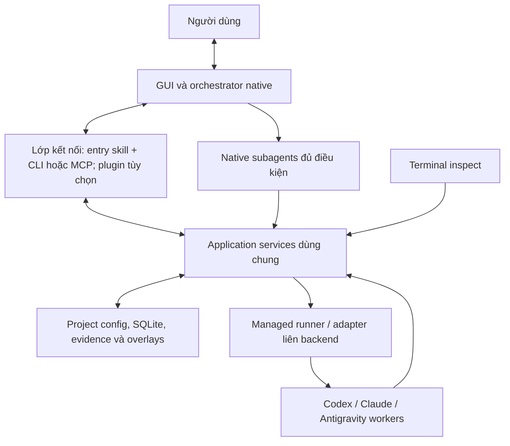

# Kế hoạch tích hợp GUI backend và terminal inspect — bản 2

Ngày: **29/10/2026**. Trạng thái: **đã implementation phần mềm 0.7.0; GUI live acceptance còn pending**. Baseline trước đợt này là source **0.6.0 / state-handoff v4**; v4 giữ compatibility, GUI services yêu cầu explicit upgrade v5. [Báo cáo implementation và sử dụng](gui-integration.md), [evidence](verification/gui-evidence.json). Chọn project entry + CLI transport; plugin/MCP không bắt buộc. Không chạy model/benchmark, cài global plugin hoặc migrate project thật trong đợt này. Giữ tên file cũ để không làm hỏng liên kết.

Đây là hướng kiến trúc tiếp theo của [runtime integration plan](runtime-integration-plan.md), kế thừa mục tiêu [Research](research-capability-plan.md) và [extensions](extensions.md). Những quyết định chuyển trách nhiệm trong tài liệu này thay roadmap tương ứng ở plan cũ; không biến capability đề xuất thành capability đã hoạt động. [Protocol nghiệm thu](plugin-acceptance-plan.md) là phần đi kèm.

## 1. Kết luận và mục tiêu

Xây **tích hợp GUI qua lớp kết nối mỏng + một lõi dùng chung + adapter worker khi cần + terminal inspect**. Plugin là lựa chọn đóng gói theo host, không là điều kiện sử dụng GUI. Agent đang trò chuyện với người dùng là orchestrator mặc định. Backend sở hữu model/tool loop, giao diện, native conversation và các chức năng native đủ điều kiện; lõi sở hữu trạng thái nghiên cứu, phiên bản cấu hình, tính hợp lệ của kết quả và phối hợp liên backend.

Người dùng mở project, gọi entry skill/hướng dẫn đã kết nối và giao việc bằng hội thoại. Các yêu cầu như “riêng project này đổi evaluator sang Claude”, “thêm kiểm tra leakage”, “giữ tiến độ và đổi giả thuyết” được chuyển thành thay đổi có phạm vi, phiên bản và thời điểm áp dụng. Terminal inspect là màn hình theo dõi tùy chọn; không buộc người dùng học CLI hoặc sửa JSON để vận hành thường ngày.

Bundle được quản lý theo version ở host; nếu cần plugin, nó tham chiếu cùng core. Mỗi project chỉ tạo config/state/overlays và binding cần thiết. Không chép cả môi trường Python, toàn bộ skills hoặc lịch sử chat vào từng project/context. Research vẫn hỗ trợ tri thức mới, toán, proof obligations, thiết kế thực nghiệm, phản chứng, paper và các đầu ra thích hợp. Báo cáo là deliverable của dự án xây hệ thống, không giới hạn đầu ra của nghiên cứu.

### Những lựa chọn được đề xuất

1. Codex desktop là host đầu tiên. Claude Code desktop và Antigravity là các host tiếp theo, không đánh đồng với Claude chat, cloud hoặc mọi IDE extension.
2. Một domain core và một bộ hướng dẫn chuẩn; manifest, hooks và native agent templates là lớp chuyển đổi nhỏ cho từng host.
3. CLI và MCP dùng chung application services. Bắt đầu từ CLI/entry guidance để có baseline đơn giản; dùng local MCP stdio khi cần structured tools, binding và lỗi có schema trong GUI. Quyết định tại PG0 theo host, không bắt triển khai cả hai bootstrap routes cho mọi host. Plugin chỉ thêm khi giúp installation/discovery/versioning hoặc host yêu cầu.
4. Native subagent được ưu tiên theo yêu cầu của task và bằng chứng capability; managed runner hiện tại vẫn phục vụ task cần bảo đảm mà host chưa cung cấp và worker liên backend.
5. Không xây TUI/chat/session scheduler thứ hai. Không thêm runtime agent framework nếu chưa có lợi ích cụ thể vượt chi phí tích hợp.
6. Không xóa module chỉ vì trùng tên chức năng. Chỉ thay sau khi so sánh quyền, trạng thái, provenance, lỗi và chi phí của đường thay thế.

## 2. Nghiên cứu và mức bằng chứng

### 2.1. Nguồn sơ cấp đã đọc

| Nguồn | Quan sát liên quan | Hệ quả thiết kế đề xuất |
|---|---|---|
| [OpenAI plugin packaging](https://developers.openai.com/plugins/build/plugins) | Portable manifest, skills, MCP và phần cấu hình riêng OpenAI; local/repo marketplace phụ thuộc surface; hooks desktop có điều kiện cài/trust riêng | Sinh gói theo host, kiểm actual loader; không giả cài manifest là đã có hooks hoạt động |
| [Codex subagents](https://learn.chatgpt.com/docs/agent-configuration/subagents) | Có subagent native và cấu hình model/effort; khả năng/điều kiện delegation theo client | Giữ role/model tách biệt; đo binding thực tế, không suy từ tên role hoặc model cha |
| [Codex hooks](https://learn.chatgpt.com/docs/hooks) | Có session, tool, compact, subagent và interrupt events; Interrupt/SessionEnd không bao phủ subagent như root; hooks phù hợp có thể chạy đồng thời | Chỉ dùng sự kiện có thật; deduplicate; không suy interrupt root là cả cây đã dừng |
| [Claude plugins](https://code.claude.com/docs/en/plugins) | Bundle skills/agents/hooks/MCP; metadata của plugin bật có footprint trong context, MCP chạy theo session | Bật theo project/profile; giữ catalog nhỏ, tránh kích hoạt mọi công cụ |
| [Claude subagents](https://code.claude.com/docs/en/sub-agents) | Agent definitions có model, tools và scope | Render từ contract chung, kiểm quyền/effort thực tế trước chọn route |
| [Claude hooks](https://code.claude.com/docs/en/hooks) | SubagentStop có agent identity/transcript refs; một số internal agents cũng phát event | Lọc task đã đăng ký; hook stop không tự chứng nhận artifact hoặc process descendants |
| [Antigravity plugins](https://antigravity.google/docs/plugins/) | Bundle skills, agent templates, rules, MCP, hooks; có khác biệt theo surface | Manifest/paths riêng; dùng shared core, không fork workflow nghiên cứu |
| [Antigravity subagents](https://antigravity.google/docs/subagents/) | Native delegation, workspace options và custom agents; context có thể tách khỏi parent | Không giả mọi backend fork cùng lịch sử; truyền evidence packet có giới hạn |
| [Antigravity hooks](https://antigravity.google/docs/hooks/) | Các event được tài liệu hóa không hoàn toàn giống Codex/Claude | Không tự tạo ánh xạ SubagentStop/Interrupt tương đương khi thiếu bằng chứng |
| [MCP transports, bản 2025-11-25](https://modelcontextprotocol.io/specification/2025-11-25/basic/transports) | JSON-RPC; stdio và Streamable HTTP | Chọn stdio local trước, negotiate protocol thực tế; không cần mở HTTP port mặc định |

Các kết luận về kiến trúc trong phần còn lại là suy luận/đề xuất của dự án, không phải cam kết của nhà cung cấp. Endpoint MCP elicitation đã thử đọc nhưng không truy cập được trong lượt nghiên cứu; không lấy elicitation làm dependency bắt buộc. Không dùng screenshot/UI automation để điều khiển backend khác thay API chính thức.

### 2.2. Inventory cục bộ ngày 29/10

| Executable đã kiểm | Version trả về | Giới hạn |
|---|---|---|
| Codex tại `AppData/Local/OpenAI/Codex/bin/0ab0e7a8f3779036/codex.exe` | `0.165.0-alpha.1.2` | Có cảnh báo quyền với temp/PATH alias; version đọc được. Không chứng minh plugin/GUI protocol pass |
| Claude tại `.local/bin/claude.exe` | `2.1.310` | Metadata CLI, không chứng minh desktop dùng cùng runtime |
| AGY tại `AppData/Local/agy/bin/agy.exe` | `1.4.7` | Metadata CLI, không chứng minh IDE/app loader cùng version |

Pin Codex cũ `0.164.0-alpha.11.1` và đường executable cũ không còn đại diện cho binary hiện tại. Không sửa pin hoặc nâng cấp software tự động trong bước lập plan. PG0 phải ghi app build, CLI runtime, host surface và protocol/capability receipt riêng. “Tài liệu mới nhất”, “đang cài” và “đã nghiệm thu” là ba trạng thái khác nhau.

### 2.3. Những thiếu hụt đã xác định trong source

- `native-tools.mjs` buộc công cụ vào một parent attempt do harness tạo; GUI session chưa có attach contract độc lập.
- `codex-native.mjs` có đường mở App Server riêng; không phải cầu nối tự gắn vào cuộc chat GUI đang mở.
- `extension-native.mjs` hiện chặn ambient MCP/hooks; worker extensions tắt apps/plugins. Cần profile host/worker mới, không xóa guard toàn cục để plugin chạy.
- `improvements.mjs` có overlay Markdown theo project; chưa có transaction chung cho conversational config, overlay và capability changes.
- `context.mjs` đã có frontier và paged reads nhưng còn dựng packet lớn ở đường managed worker. Plugin không nên nạp lại packet đó ở mọi turn.
- Model policy không tự đổi model của GUI. GUI usage/host tools chưa được ledger tự động bao phủ.
- SQLite writer v4 không hiểu attachment/native execution mới. Không ghi thêm trạng thái quan trọng rồi để writer v4 cũ tiếp tục thay đổi nó.

## 3. Kiến trúc đích và ownership

| Trách nhiệm | Owner |
|---|---|
| Chat UI, hiển thị artifact/diff, native context management, tool loop | Host backend |
| Chọn hướng nghiên cứu, chia việc, tổng hợp, trao đổi người dùng | Orchestrator native, theo skills/policy |
| Execution sống/chết, native job handles | Provider thực thi; core giữ observations và phần chưa biết |
| Task revision, assignment, result validity, research record, config revision | Core duy nhất của project |
| Thu thập sự kiện native và chuyển đổi định dạng | Host adapter/hook, không tự lập kế hoạch |
| Đọc/ghi filesystem bằng agent | Sandbox/quyền của host; plugin không tạo OS isolation bằng prompt |
| Admission, publication, bằng chứng và quyết định dự án | Core; UI approval không tự thay scientific acceptance |

Một plugin install không tạo quyền truy cập mọi project. Attach bind canonical workspace, project ID, host/session identity nếu có, owner epoch, runtime/plugin versions và scope. Nếu không có session ID đáng tin cậy, ghi local attachment identity, không gọi đó là verified native identity. Các tool call phải mang binding do transport tạo; agent không tự chọn workspace tùy ý trong mỗi payload. Chống path traversal, junction/symlink ngoài phạm vi và nhầm project khi mở nhiều tab.

Core bảo vệ đường công cụ do nó quản lý. GUI agent có quyền shell rộng vẫn có thể đi ngoài core; không quảng cáo plugin là rào chắn hệ điều hành. Nếu task yêu cầu isolation/enforcement mạnh hơn host cung cấp, chọn managed isolated route.

## 4. Công cụ kết nối GUI và lifecycle

Đã có 8 nhóm action qua GuiService và gui-action; xem gui-catalog để lấy required/optional fields. Init/attach và human confirmation là lifecycle/CLI paths riêng, không expose thành tool tự duyệt. Không có MCP transport trong bản này.

| Nhóm | Chức năng |
|---|---|
| `project` | Attach/init/status/detach; inspect effective config, provenance và inventory theo scope |
| `change` | Prepare/inspect/apply/rollback config/overlay có revision và quyền phù hợp |
| `work` | Register/prepare/dispatch/observe/control/submit; trả operation handle cho việc dài |
| `research` | Record/read/review/export hypotheses, derivations, experiments, claims, feedback |
| `evidence` | Read có giới hạn, pin/validate artifact, receipt và publication status |
| `capability` | Discover profile/describe helper, execute helper có binding; không tự cài tùy ý |
| `decision` | Ghi câu hỏi, lấy pending, tiếp nhận câu trả lời có nguồn và revision |
| `diagnostic` | Usage/errors/checkpoints/handoff, xuất gói chẩn đoán có chọn lọc |

Từng action có input schema nhỏ; JSON lớn, logs và tài liệu trả ref/cursor. Có thể tách tool khi client hỗ trợ schema của action không tốt; số lượng không phải mục tiêu cứng để hy sinh độ rõ.

### Attachment và restart

1. Entry skill gọi preflight/attach qua route đã chọn; trả task frontier, pending decisions/jobs, effective policy digest và capability availability. Project mới lấy template snapshot, không chạy inference để tạo boilerplate. Inspect độc lập không cần attachment có quyền ghi.
2. Chỉ một owner epoch có quyền dispatch thay đổi; các GUI khác có thể đọc. Tiếp quản phải fencing owner cũ, không suy chat trước đã chết.
3. MCP server tồn tại theo connection/session; khởi động lại đọc DB. Long-running execution không giữ một MCP request vô hạn: submit intent rồi trả handle, status dùng cursor hoặc bounded wait.
4. Giữ process supervision của runner hiện có. Không dựng daemon toàn máy trước khi cần. Nếu host chết kéo theo worker/bridge, ghi unknown khi reconnect; không cam kết chạy tiếp khi đóng GUI hoặc mất điện.
5. Session kết thúc không xóa project; uninstall plugin giữ config/state/artifacts. Dữ liệu project không nằm trong plugin cache dễ bị thay khi update.

Local MCP ưu tiên SDK chính thức được pin nếu giảm rủi ro protocol; core có thể tiếp tục stdlib. Không cố giữ zero-dependency bằng cách tự viết thiếu lifecycle/JSON-RPC. CLI và MCP gọi cùng service functions, không subprocess CLI cho từng tool nếu có thể gọi trực tiếp. MCP sampling không dùng để mở thêm LLM loop.

## 5. Chọn đường thực thi và subagent

Ba đường rõ ràng: **inline native**, **native subagent**, **managed worker**. Quyết định dựa trên giá trị công việc, capability cần và chi phí tổng, không mặc định nhiều agents tốt hơn.

| Công việc | Đường ưu tiên | Record tối thiểu |
|---|---|---|
| Hỏi trạng thái/giải thích, thao tác xác định | Core trực tiếp/GUI trả lời | Không tạo artificial task/attempt để hỏi status |
| Một bước nghiên cứu nhỏ | Inline native | Task/work record và evidence khi phát sinh claim/output cần truy vết |
| Nhánh độc lập cùng backend | Native subagent đủ điều kiện | Assignment, native binding/observations, result refs |
| Backend khác hoặc yêu cầu native chưa đáp ứng | Managed worker | Lifecycle/quota/checkpoint/publication hiện có |

Researcher/implementer/evaluator là trách nhiệm logic, không bắt spawn ba process. Một agent có thể đảm nhiệm nhiều bước; kiểm tra độc lập dùng evidence/method khác hoặc evaluator riêng khi có lợi ích. Tầng planning vẫn tự research/verify nguồn chính và có quyền bác analysis.

Mỗi provider phải khai `documented/observed/verified` cho: model/effort, instruction loading, identity, start/result, usage scope, steer/cancel, descendants, checkpoint/export, filesystem scope và plugin inheritance. Native route chỉ được dùng khi đáp ứng các yêu cầu thực sự của task. Những thứ không đo được ghi unknown, không bịa “0 token”. Không tự giảm yêu cầu task để đạt native routing.

Managed `run-orchestrator` thành tùy chọn headless/compatibility. GUI là root orchestrator, mặc định analysis/medium; không khởi chạy một root điều phối thứ hai. Khi cần kế hoạch khoa học, giao task synthesis_planning/highest riêng cho cố vấn (thường researcher), kèm analyses và bằng chứng gốc; nhận kế hoạch đã research/verify độc lập rồi tổ chức thực hiện. Native subagent hoặc managed worker phải đáp ứng model/effort và requirements; nếu không có đường phù hợp thì báo blocked, không coi config là đã đổi model GUI. Không gọi cố vấn cho mọi tác vụ nhỏ/status.

Mapping cập nhật 31/10/2026: cố vấn planning `gpt-6-astra/high`; orchestrator/analysis `gpt-6.1-sol/high`; automation mặc định Antigravity `gemini-3.8-flash-high/high` qua task_class_backends. Claude và các tier còn thiếu của AGY chưa cấu hình; không suy model tương đương. Thao tác deterministic dùng script; explicit/frozen selections giữ nguyên và không tự fallback Gemini sang Codex.

### Native admission có hai mức quan sát

- **Managed:** core ghi intent/admission trước dispatch và biết job handle; áp dụng các giới hạn trong phạm vi nó kiểm soát.
- **Native observed:** nhận identity/events sau hoặc quanh native spawn. Nếu không có pre-spawn interception đáng tin cậy, không hứa hard global concurrency/budget. Task yêu cầu hard admission dùng managed route.

Không để cả core lẫn backend retry cùng assignment. Mỗi execution có provider owner và idempotency key. Timeout/lost reply giữ dispatch outcome unknown; chỉ retry khi chứng minh chưa submit hoặc đã kết thúc và có recovery decision. Native stop event chỉ là observation; không giải phóng reservation của external job chưa rõ.

## 6. Tùy chỉnh project bằng hội thoại

Precedence dự kiến: **versioned defaults → project profile snapshot → project overrides → task overrides**. Permission/capability constraints được giao nhau, không overwrite theo “last wins”. Template update không tự thay project cũ. Mọi effective field có source/revision; `null`, xóa override, thay array và merge object có semantics được schema quy định, tránh deep merge mơ hồ.

Một change request chứa: project/base revision, yêu cầu người dùng hoặc message ref nếu host cung cấp, patch/diff, phạm vi, affected tasks, thời điểm hiệu lực, validation, authorization source và rollback target. Các trạng thái: proposed → validated → pending_user hoặc ready → applied/blocked/rejected; không dùng “đã ghi file” thay “đã có hiệu lực”.

Ba đích cấu hình cần phân biệt: (a) core project config áp dụng bằng service; (b) host project config/agent definitions được render thành patch theo schema host, có reload boundary; (c) host/global/account settings bị managed policy hoặc API giới hạn. Với (c), báo unsupported hoặc thao tác người dùng còn cần, không giả project override có hiệu lực. Ví dụ Codex không cho project config thay provider/auth; Claude plugin agent có trường quyền/MCP bị bỏ qua. Không giữ hai bản config cùng được sửa độc lập: file render có source revision/hash, phát hiện sửa tay là conflict cần reconcile. Không tự ghi đè file người dùng sở hữu.

| Yêu cầu | Xử lý |
|---|---|
| Đổi lựa chọn trong quyền đã cấp cho một task | Override và ghi nhận; không hỏi lại cùng quyền |
| “Từ giờ riêng project này…” | Project revision mới, effective preview; apply khi an toàn |
| Thay hướng dẫn nghiên cứu | Overlay Markdown có hash, checks và version; nạp ở context tiếp theo |
| Tăng budget/quyền, đổi câu hỏi chính/acceptance, publish | Áp dụng policy và xác nhận còn thiếu; không tự cấp quyền |
| Yêu cầu chức năng mới | Change task sửa code/package + tests + activation riêng, không ép thành config giả |
| Sửa mặc định cho dự án sau | Template revision mới; không sửa mọi project đang dùng |

Config và overlay liên quan được stage ngoài transaction rồi commit bằng expected revision/CAS. Implementation dùng **một SQLite transaction cho config và active immutable overlay pointer**, thay cho journal activation đa tài nguyên dự kiến: activation không rewrite files, nên crash giữ cặp cũ hoặc cặp mới. Publication outputs vẫn dùng journal riêng. Rollback tạo revision mới, không xóa lịch sử; không hoàn tác side effects nghiên cứu bằng cách đổi config. Không sửa trực tiếp global/personal backend skills từ yêu cầu chỉ áp dụng project.

Worker đang chạy giữ frozen effective config. Steering chỉ dùng để bổ sung phù hợp capability; thay input/protocol/model/permission cần checkpoint/revise/restart. Activation có thể queued đến safe boundary. Parent GUI attachment tồn tại lâu không được coi là active worker khiến mọi config update bị khóa mãi; chỉ chặn những execution bị ảnh hưởng. Backend reload skill/model hạn chế phải được báo rõ và lấy receipt ở session/attempt tiếp theo.

Prompt tự nhiên là đầu vào cho orchestrator, không là proof người dùng đã duyệt cho core. Nếu host cung cấp user-event provenance thì bind request/digest đó; nếu không, approval nhạy cảm cần native UI/explicit human path có thể xác minh. MCP client approval cho phép gọi tool không mặc nhiên là approval đúng protocol benchmark. Không giả model tự truyền `approved:true` là human consent.

## 7. HITL, ngắt và đổi orchestrator

- Câu hỏi/status/bổ sung của người dùng không mặc định hủy mục tiêu. Lệnh dừng rõ ràng tạo control event sớm; phản hồi riêng received, applied, verified stopped.
- Root GUI Stop có thể chỉ dừng root. Hook Interrupt (nếu có) chuyển event scoped tới jobs thuộc project/assignment, không kill theo tên process hoặc mọi backend trên máy.
- Pending decision lưu question, alternatives, affected revision, deadline nếu cần, result của câu trả lời. Câu trả lời muộn sau revise phải bị từ chối/review.
- Native question/notification qua host APIs được ưu tiên. Nếu client không hỗ trợ elicitation/push, status tool trả pending decision để orchestrator hỏi ở lượt tương tác tiếp theo; không claim proactive notification khi chat idle.
- Đổi backend điều phối: checkpoint + handoff refs, release/take owner theo epoch, reconcile jobs. Không chuyển private chain-of-thought hoặc coi native session của hãng A là session hãng B.
- Hooks chỉ chạy script hữu hạn; không gọi model mỗi event. Nếu hook không được trust/load, hiển thị capability degraded; quản lý task quan trọng dùng explicit tools/managed route.

## 8. Research helpers và workspace

Một capability registry chọn native tool hoặc helper đã pin theo input/output contract. PDF native đủ tốt để đọc thì dùng native; khi cần số trang, bytes/hash/render evidence có cấu trúc mà native không trả, dùng helper hiện có. Tương tự cho bibliography/math/stats: không xóa phép tính kiểm chứng chỉ vì backend có thể viết Python.

Giữ controlled helpers, raw artifacts và environment lock cho tác vụ lặp lại. Installer chỉ provision thiếu dependency; environment có thể dùng chung immutable theo version/platform, cache ở host, project ghi binding. Không cài package ở mỗi attach. Workspace-specific data không lưu trong shared cache.

Chuyển extension guard thành profile tường minh: GUI controller plugin, native worker tối thiểu, managed isolated worker. Allowlist chỉ exact plugin/MCP/hooks cần; không bật mọi ambient extension. Không để worker kế thừa công cụ dispatch/approval của orchestrator ngoài scope.

Native worktree/workspace có thể thay snapshot copy sau khi xác minh mapping, input identity, output scope và lifecycle. Workspace không có Git vẫn dùng snapshot_directory; không tự init Git. Native GUI edits trong root cần ghi evidence theo phiên bản, nhưng không được gắn nhãn “journaled isolated publication” nếu đi ngoài journal. Parallel writers chỉ cho phép khi chứng minh isolation/conflict handling; nếu chưa, serialize đúng scope.

## 9. Bản đồ giữ, rút gọn, thay thế

| Module hiện có | Hướng xử lý | Điều kiện trước bỏ phần cũ |
|---|---|---|
| `research.mjs`, `planning.mjs`, research schemas/skills | Giữ scientific contracts; render guidance theo nhu cầu | Không giảm planning audit hoặc mất phản chứng/proof obligations |
| `config.mjs`, `models.mjs`, `improvements.mjs` | Mở rộng project revisions/changes, hợp nhất activation | Config provenance, CAS/rollback và quyền được kiểm |
| `store.mjs`, `engine.mjs`, `work.mjs` | Giữ core; tách attachment và execution provider khỏi managed process assumptions | Migration/writer fencing; không duplicate state machine |
| `context.mjs`, `bundle-cache.mjs` | Tách bootstrap/frontier/evidence packet; native skill loading có điều kiện | Actual loaded instructions theo profile; không nhồi schema mọi turn |
| `native-tools.mjs` | Extract application services, reuse qua MCP/CLI/native callbacks | Một validation/authorization path, parity tests |
| `runner.mjs`, `adapters/index.mjs` | Giữ cho cross-backend/strict managed work; native host không đi vòng runner | Native lifecycle/result đủ cho từng task trước thay |
| `codex-native.mjs`, `native-rpc.mjs` | Giữ driver external worker; bỏ khỏi bootstrap GUI mặc định | GUI attachment không cần spawn second root |
| `native-state.mjs`, `native-recovery.mjs` | Chia provider observations và portable recovery | No double accounting; unknown không auto-complete |
| `resources.mjs`, `failures.mjs` | Giữ quota pooling/admission; dùng native telemetry khi có | Không suy quota subscription thành token budget chính xác |
| `checkpoints.mjs`, `recovery.mjs` | Giữ portable progress; native resume là optimization | Reconcile trước resume/retry; không reset completed units |
| `workspaces.mjs`, `publication.mjs` | Giữ publish validation; thêm provider workspace khi cần | CAS/conflict/partial publish recovery tương đương |
| `blobs.mjs`, `receipts.mjs`, `artifacts.mjs` | Giữ immutable evidence; dedup file reads/snapshots | Native tool output vẫn truy vết được |
| `extensions.mjs`, `extension-runner.mjs`, `extension-native.mjs` | Registry/native reuse, profile guards phù hợp plugin | Scope/receipts/environment binding không mất |
| `benchmarks.mjs` | Giữ per-run approval và frozen scope | Plugin không tự confirm hoặc dùng approval cũ |
| `report.mjs`, `scripts/harness.mjs` | Shared services + diagnostics; CLI rescue | Không phát triển hai implementation song song |

Không hứa giảm X% code/token. Lập deletion ledger cho từng đoạn đã có replacement verified; loại imports/schema/tests chết cùng lúc. Giai đoạn chuyển đổi có thể tăng code tạm thời. Không tối ưu SQLite sang hệ storage mới trong cùng đợt trừ khi profiling chỉ ra vấn đề chặn.

## 10. Chi phí và quan sát

Bootstrap đề xuất <=8 KiB UTF-8 gồm hướng dẫn riêng và frontier mặc định (không tính user task hoặc tool catalog của host); đây là target kỹ thuật mới, không phải đo hiện tại hoặc quy đổi token. Khi vượt, trả index/cursor + cảnh báo phần còn lại, không cắt bỏ assumptions âm thầm. Worker packet giữ refs và acceptance thiết yếu, không nhúng transcript tích lũy.

Catalog luôn bật chỉ entry skill và các nhóm tools cần. Role/guidance nạp khi sử dụng, không tạo thêm LLM lượt “chọn skill”. Static instructions tách dynamic status để tạo điều kiện cache; không cam kết cache subscription giảm quota tương ứng. Không full-history fork mặc định; dùng packet nhỏ, full fork chỉ khi context có giá trị và chi phí được chấp nhận.

Ghi riêng host root, native children, managed children và HTTP/helper usage. Counter có ID/epoch/baseline/scope/coverage; parent inclusive children không cộng children lần hai. Host không cho usage thì root unknown và báo totals là partial. Quota pools cùng tài khoản được chia sẻ, nhưng hoạt động ngoài hệ thống làm snapshot stale; admission chỉ là ước tính nếu không có hard provider enforcement.

Metrics lấy từ sử dụng thật: bootstrap/tool-result bytes, loaded skill bytes nếu quan sát được, usage known/unknown, số delegation/retry, thời gian startup/helper/recovery, calls để đổi config, số lần hỏi lại và lỗi cản trở. Không bật transcript capture vô hạn. Log có timestamp/project/task/attempt/call correlation, bounded size/rotation và stack/cause cho lỗi nội bộ; raw evidence/checkpoints có retention riêng, không bị xoay log xóa mất.

Xuất diagnostic bundle theo lựa chọn, redaction secrets mặc định, không tự gửi ra ngoài. Với filesystem lỗi không thể hứa mọi log đã flush; stderr và status phải nêu phần thiếu. Không có LLM tóm tắt logs tự động trừ khi người dùng cần phân tích lỗi.

## 11. Triển khai theo cổng nghiệm thu

Các mã PG được giữ để nối coverage cũ. Mỗi phase là lát cắt dùng được, không phải yêu cầu rewrite toàn bộ trước khi GUI hoạt động.

**Tiến độ implementation 29/10:** PG0 chọn CLI route; PG1a/PG1b có inspector và state5 services; PG2 có project entry/catalog/connection; PG3/PG4 có async managed/native-observed/research/helper/overlay bridges; PG6 có bindings cho ba hosts, AGY manual-entry; PG7 có install/uninstall/rollback/deletion ledger và regression **225/225 pass, 74 JS + 4 Python checks, recovery demo pass**. [Hướng dẫn và coverage](gui-integration.md), [evidence phần mềm](verification/gui-evidence.json). PG5 live GUI và deep host identity/inventory/model/control verification chưa chạy; I0 human layout còn chờ review. Không nâng native/GUI thành verified từ fixtures hoặc connection generation.

| Giai đoạn | Deliverables cụ thể | Dependency / điều kiện hoàn thành |
|---|---|---|
| **PG0 — capability contract** | Matrix theo host build/runtime/surface; lựa chọn CLI/MCP/packaging; inventory reader contract; route requirements, old→new behavior map | Ghi bằng chứng và unknown; metadata mới; không sửa pin chỉ để probe pass |
| **PG1a — inspect độc lập** | Shared read model, terminal renderer, JSON/full/section, redaction, config drift, historical native receipts; [spec](project-inspect-plan.md) | Read-only trên v4, uninitialized/broken config vẫn chẩn đoán được; không migrate/spawn/inference |
| **PG1b — core service và storage** | Extract phần CLI/native handlers cần tái dùng; attachment; config changes/CAS; activation journal; migration nếu thêm durable state | Fake-client/recovery tests pass; writer cũ bị chặn khi schema đổi; inspect dùng được cả trước/sau migration |
| **PG2 — Codex GUI tối thiểu** | Entry guidance + transport đã chọn, attach/frontier/read/change; launcher Windows; plugin wrapper chỉ khi PG0 xác định lợi ích | Một đường GUI dùng được; structured schemas và scope; không tạo root orchestrator thứ hai |
| **PG3 — execution bridge** | Inline/native/managed route; scope receipts; bounded async handles; native events/control/decision; planning tier guard | Conformance suite cho jobs/results/usage; managed fallback hoạt động; scope fail rõ |
| **PG4 — Research và customization** | Role/skill render, overlay revisions, helper-native selection, pinned environment reuse, artifact acceptance | Một workflow nghiên cứu có thể ghi đủ claims/derivation/experiment/counterevidence bằng fixtures |
| **PG5 — Codex nghiệm thu thực tế** | Protocol nhỏ hoặc trace task thật được phép; GUI request→worker→evidence→interrupt/recovery theo coverage thiếu | Human review, model/scope observed; không dùng fixture chứng minh native works |
| **PG6 — Claude/Antigravity** | Host bindings từ core chung; config render/inventory/agent template theo surface; package tùy chọn; mapping model được chấp nhận | Không fork core; metadata trước, live từng host khi dùng/được duyệt; native thiếu thì managed theo requirements |
| **PG7 — tinh gọn và bàn giao** | Xóa đoạn redundant có replacement evidence; docs install/uninstall/rollback; system report, known limits | Regression required checks pass; deletion ledger; không xóa route duy nhất đang bảo vệ invariant |

Thứ tự: PG0 → PG1a → PG1b → PG2 → PG3/PG4 → PG5 → PG6/PG7. PG1a có giá trị ngay trên hệ thống cũ; không phụ thuộc MCP hoặc plugin. PG3 giữ managed cross-backend ngay từ bản Codex; PG6 bổ sung host điều phối khác, không trì hoãn toàn bộ khả năng liên backend đến PG6. Mỗi lát cắt chạy offline tests liên quan, full suite ở mốc runtime theo AGENTS.md. Một Codex usable release không phải chờ mọi host accepted. Các native routes chưa đủ evidence vẫn có trạng thái conditional.

### Storage/package migration

- Dự kiến state/handoff **v5** vì attachment/provider/config changes là trạng thái writer v4 không hiểu. Chốt schema trước implementation, không đánh dấu source hiện tại đã nâng version.
- Backup snapshot; migration khi không còn active/unknown work hoặc pending publication. Có rescue/read-only đường cũ để kết thúc/reconcile trước migrate. Writer guard v5 chặn v4 ghi.
- Copy/upgrade môi trường thử nghiệm trước; rollback code dùng backup trên workspace riêng. Rollback config không downgrade schema.
- Plugin package immutable/versioned; mutable project config/state ngoài package. Không hard-code username hoặc hash directory của binary desktop. Resolve executable rồi ghi exact version/digest, mismatch mở preflight lại.
- Giữ CLI cứu hộ cho lỗi GUI/plugin/MCP không khởi động; nó cùng application service, không cho bypass scientific/human guards.

## 12. Rủi ro và điểm cần chốt bằng evidence

| Rủi ro | Cách xử lý / cổng |
|---|---|
| Plugin có docs nhưng host cục bộ không load được thành phần | PG0 probe + PG5 route trace; fallback skills/CLI cùng core; không claim plugin-native accepted |
| Native không có hook pre-spawn hoặc identity/usage đủ | Chọn managed cho task cần admission; native observed có limitation rõ |
| GUI model không đúng planning tier | Một planner đúng tier hoặc human model switch, không silent downgrade |
| MCP server chết/GUI đóng làm mất reply | Persist intent/idempotency, reconnect/reconcile; không blind resubmit |
| Config đổi giữa hai GUI hoặc giữa run | CAS revision + owner epoch + pinned effective configuration |
| Global plugin inheritance làm worker có quyền ngoài scope | Exact profile verification, disable dư ở scope worker; không sửa global config tùy tiện |
| Native workspace edits đi ngoài publication | Label execution route và acceptance boundary, giữ managed isolated route cho yêu cầu tương ứng |
| Model giả lập human approval trong payload | Bound decision/user evidence; không coi tool approval hoặc hook text là consent đầy đủ |
| Plugin overhead lớn hơn CLI | Measure bytes/process startup in-use, giảm catalog/hooks; không chạy A/B benchmark mặc định |
| Backend tự update | Mark capability evidence stale theo build/protocol; giữ data; kiểm đúng phần thay đổi |

Tiêu chí nghiệm thu chi tiết ở [plugin-acceptance-plan.md](plugin-acceptance-plan.md). Không đánh giá “đã tạo tri thức mới” bằng một benchmark bắt buộc. Hiệu quả nghiên cứu, chất lượng phân công và độ tiện của hội thoại được tối ưu từ dự án thật.

## 13. Bước triển khai đầu tiên sau khi người dùng duyệt hướng đi

Phần software đã được triển khai theo thứ tự trên. Dùng connect-gui cho project đích, inspect/review trước activation, rồi lấy trace của task thật được phép hoặc xin duyệt live protocol riêng nếu cần. Plugin/MCP vẫn mở rộng theo lợi ích; native hooks/inventory chưa có evidence thì giữ unknown và managed fallback. Live benchmark vẫn cần protocol/xác nhận riêng.

## 14. Phạm vi release và tối ưu có điều kiện

Release đầu cần: Codex GUI entry, project binding, thay config qua hội thoại có preview/effectivity, inspect, core research/evidence, managed cross-backend contracts và rescue CLI. Native subagent bật cho task có đủ capability receipts; chưa đủ thì nêu giới hạn và chọn route tương ứng. CLI provider thật vẫn cần evidence riêng, không lấy mocks chứng nhận mọi backend.

Packaging nhiều host, deep live inventory cho mọi GUI, watch-mode/TUI, warm reuse/native auto-resume chỉ mở rộng khi có nhu cầu và bằng chứng lợi ích. Đây là thứ tự triển khai, không bỏ các capability đã chốt. Mỗi capability có decision record: lợi ích cụ thể, native sẵn có, phạm vi bảo đảm, chi phí context/process/storage/maintenance, fallback và coverage tối thiểu. Không đánh đổi scientific contracts, khả năng liên backend hoặc độ bền để giảm số dòng code.

Tự vận hành trong GUI phải giữ hai đường rõ: yêu cầu công việc và tùy chỉnh qua hội thoại; quan sát toàn cảnh qua terminal inspect. Orchestrator chỉ đọc section/delta cần thiết. Người dùng có thể xem full mà không đẩy toàn bộ config/logs vào context. Transport/packaging không tạo thêm planner, không polling LLM và không provision environment mỗi project.
