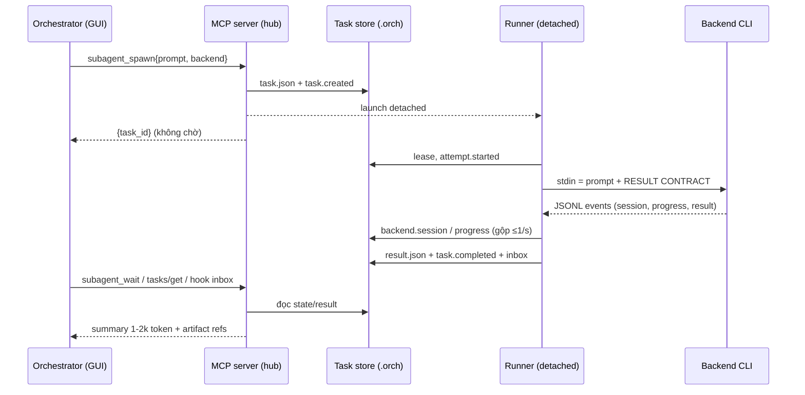

# 01 — Thiết kế vòng 1: Hub điều phối subagent đa backend (Claude Code · Codex · Antigravity)

> Trạng thái: bản thiết kế r1 kèm mã nháp tại `../src`, với 28/28 test pass trên Windows 11 và Node 26.
> Quy ước nhãn: **[KC]** là đã kiểm chứng từ nguồn (notebook hoặc tài liệu chính thức, có ghi rõ nguồn). **[GĐ]** là giả định hoặc suy luận, chưa kiểm chứng. **[TEST]** là đã có test đơn vị trong `src/test`.

---

## 0. Tóm tắt kiến trúc

```
   GUI orchestrator (một trong ba: Claude Code | Codex | Antigravity)
   ├─ native subagent của chính nó ........ (đường tắt cho việc ngắn, chỉ đọc, trong phiên)
   └─ MCP client ──stdio──► subagent-hub MCP server (stateless, cùng một server cho cả 3 GUI)
                                 │  spawn → trả task_id NGAY (ms)
                                 ▼
                          Task store trên đĩa  (.orch/)
                          tasks/<id>/{task.json, events.jsonl, state.json, lease.json,
                                      control/, attempts/<n>/raw.jsonl, artifacts/, result.json}
                          inbox/  slots/  idem/
                                 ▲  ghi journal (một writer, giữ lease)
                                 │
                 runner tách rời (một tiến trình node cho mỗi task, sống sót khi GUI tắt)
                 └─ adapter ──spawn CLI headless + parse luồng JSON──► claude -p --output-format stream-json
                                                                      codex exec --json
                                                                      agy -p --output-format stream-json
```



Tóm tắt trong 10 dòng:
1. Có **một** MCP server `subagent-hub`, đăng ký giống nhau ở cả ba GUI. Bộ tool `subagent_*` không đổi theo backend, nên người dùng chỉ cần nhớ một cú pháp.
2. Hub gọi backend qua **CLI headless có luồng JSON** của từng backend. Mọi khác biệt giữa các backend nằm gọn trong adapter, mỗi adapter chừng 100 dòng.
3. `spawn` trả về ngay. Việc nặng do **runner tách rời** làm (mỗi task một tiến trình), nên GUI không bao giờ bị treo.
4. Orchestrator biết task đã xong qua ba kênh: **MCP Tasks** (nếu client hỗ trợ), **long-poll có trần 50 giây** (`subagent_wait`), và **inbox + hook**.
5. Mọi backend trả về **một định dạng** `subagent-result/v1`. Backend được ép theo RESULT CONTRACT (dùng schema native nếu backend có), hub kiểm tra lại, sai thì có một lượt sửa trong cùng phiên.
6. Orchestrator chỉ thấy **summary khoảng 1–2k token cùng tham chiếu artifact**. Transcript thô nằm trên đĩa.
7. Trạng thái là **journal append-only**, và `state` = `fold(journal)`. Mỗi task có một writer duy nhất, khóa bằng lease và heartbeat.
8. Phục hồi là **resume phiên của chính backend** (`--resume` / `exec resume` / `--conversation`), không phát lại công việc.
9. Lỗi được phân loại trước (auth, rate_limited, transient, hang, crash, bad_output, agent_failed, config) rồi mới quyết định retry, resume, failover, park hay fail.
10. Policy (quyền, ngân sách, sandbox) **chưa thiết kế**. Hiện chỉ chừa 9 hook point, mặc định là no-op.

---

## 1. Các quyết định thiết kế chính

### QĐ1 — Mặt tiền thống nhất là một MCP server stdio dùng chung cho cả ba GUI
- **Lựa chọn:** chọn `subagent-hub` làm MCP server, gồm 8 tool `subagent_spawn | wait | status | result | cancel | followup | resume | list`. Trường `instructions` của server mô tả cách dùng.
- **Lý do:**
  - MCP là bề mặt mở rộng duy nhất mà cả ba GUI đều có (đề bài giả định đủ phương thức). [KC] Claude Code dùng `.mcp.json` và Codex dùng bảng TOML `[mcp_servers.<name>]` (notebook, tài liệu Claude Code và Codex, 2026).
  - [KC] Codex đọc trường `instructions` lúc initialize làm hướng dẫn chung cho toàn server (notebook, Codex docs 2026). Nhờ vậy cách dùng đi kèm theo server, không cần dạy riêng cho từng GUI.
  - Kết quả là cú pháp gọi **giống hệt** nhau ở ba GUI, đạt tiêu chí (a).
- **Phương án bị loại:**
  - (i) Skill hoặc lệnh shell riêng cho từng GUI gọi thẳng CLI backend: ba cú pháp khác nhau, chặn GUI, không có trạng thái chung.
  - (ii) Dùng chế độ MCP-server của backend (`codex mcp-server`, `claude mcp serve`): mỗi lần gọi là một tool call **chặn suốt phiên agent**, và vòng đời gắn với tiến trình client. [KC] Server stdio bị dừng khi Claude Code thoát (code.claude.com/docs/en/mcp, 2026). `claude mcp serve` lộ công cụ của Claude Code chứ không lộ vòng agent [GĐ theo notebook].
  - (iii) A2A hoặc giao thức agent-to-agent: không backend nào có sẵn, thêm một lớp mà không có lợi ích gì.

### QĐ2 — Gọi backend bằng CLI headless có luồng JSON, không dùng SDK hay API trực tiếp
- **Lựa chọn:** adapter spawn tiến trình con theo bảng sau, prompt luôn đi qua **stdin**.

  | Backend | Lần đầu | Resume |
  |---|---|---|
  | Claude | `claude -p --output-format stream-json --verbose --permission-prompts none --strict-mcp-config` | `--resume <session_id>` |
  | Codex | `codex exec --json -o <file> --output-schema <file> -C <cwd> --skip-git-repo-check -` | `codex exec resume <id> --json -` |
  | Antigravity | `agy -p --output-format stream-json --input-format stream-json` | `--conversation <id>` |

- **Lý do:**
  - [KC] Cả ba đều có chế độ headless với luồng JSON và resume theo id:
    - Claude: code.claude.com/docs/en/headless, 2026.
    - Codex: learn.chatgpt.com/docs/non-interactive-mode, 2026.
    - Antigravity: antigravity.google/docs/cli/headless, 2026.
  - [KC] Chính tài liệu Agent SDK khuyên các ngôn ngữ khác "chạy CLI như subprocess với `-p` và `--output-format json`" (notebook, Claude Agent SDK docs). SDK TypeScript của Claude và Codex cũng bọc chính CLI này, nên CLI là **mẫu số chung thấp nhất**.
  - Mỗi lần chạy là một tiến trình riêng: crash của backend không kéo hub sập theo, và có thể kill cả cây tiến trình.
  - Dùng **đăng nhập subscription sẵn có** của người dùng. [KC] `--bare` của Claude **không** đọc OAuth hay keychain mà cần `ANTHROPIC_API_KEY`, vì vậy cố ý không dùng `--bare` mà dùng `--strict-mcp-config`.
  - Prompt đi qua stdin để tránh giới hạn khoảng 32K ký tự của dòng lệnh Windows và lỗi quoting của shim `.cmd`. [KC] Claude giới hạn stdin 10MB; Codex dùng `-` để buộc đọc stdin.
- **Phương án bị loại:**
  - SDK in-process: vòng đời gắn với hub, API ba bên khác nhau, và Python có thể không có trên PATH. Giữ lại làm "driver" tương lai cho Claude, vì SDK có `interrupt()` sạch hơn SIGTERM.
  - API model trực tiếp: mất toàn bộ harness của agent (tool, sandbox, memory).
  - Mô phỏng thao tác GUI: mong manh.

### QĐ3 — Không chặn: runner tách rời cho mỗi task, file-system-as-bus, không có daemon trung tâm
- **Lựa chọn:** `spawn` chỉ ghi `task.json` và sự kiện `task.created`, rồi launch `node runner-main.mjs <id>` với `detached`, `stdio: ignore` và `unref`. MCP server **không giữ trạng thái** và chỉ đọc hoặc ghi file.
- **Lý do:**
  - Đáp ứng (c): mọi tool call của hub trả về trong vài mili giây, trừ `wait` (có trần).
  - Server stateless nên đóng hay mở GUI, hoặc restart server, đều không mất task.
  - [KC] Claude Code chỉ tiếp tục theo dõi MCP task khi resume nếu "server vẫn còn biết task" (docs/mcp, 2026). Store trên đĩa đáp ứng đúng điều kiện đó.
  - Không có daemon tức là không có điểm chết đơn lẻ và không cần cơ chế tự khởi động.
  - [TEST] Đã chạy thật một runner tách rời trên Windows.
- **Phương án bị loại:**
  - Daemon dài hạn có IPC: thêm một dịch vụ phải giám sát, đáng làm khi có nhiều máy hoặc nhiều người dùng.
  - Temporal, Restate hoặc Inngest: notebook khuyên dùng durable engine (Temporal "Durable AI" 2025–2026; Zylos 04/2026; Fowler 2026), nhưng với một máy Windows và người dùng đơn lẻ thì cần chạy server riêng, quá nặng. Thiết kế đã **giữ nguyên mô hình** của các engine này (bước bền, journal, idempotency key, "parking" không tốn tài nguyên), nên có thể chuyển sang engine sau mà không đổi API.
  - Chạy trong tiến trình MCP server: chết theo GUI.

### QĐ4 — Ba kênh báo hoàn thành, xếp theo mức "mượt"
1. **MCP Tasks** (khi client hỗ trợ). `tools/call` trả `{resultType:"task", taskId, status:"working", pollIntervalMs}`, client tự poll `tasks/get` rồi nhận thông báo.
   - [KC] Claude Code v2.1.304+ hỗ trợ khi chạy protocol 2026-07-28. Tool call trong main conversation chạy quá 2 phút cũng tự chuyển nền (`CLAUDE_CODE_MCP_AUTO_BACKGROUND_MS`), và kết quả về dưới dạng task notification (docs/mcp, 2026).
   - Ánh xạ: `taskId` = `task_id`, `tasks/get` đọc `state.json`, `tasks/cancel` gọi `subagent_cancel`.
   - [GĐ] Cách thương lượng extension. Bản nháp chỉ nhận `params.task`.
2. **Long-poll có trần** `subagent_wait(task_ids, mode any|all, timeout ≤ 50s)`: trả về ngay khi có task kết thúc. Trần 50 giây để nằm dưới ngưỡng khoảng 60 giây mỗi request của nhiều client.
   - [KC] Claude áp ngưỡng max(60s, …) cho HTTP. Với stdio, idle timeout là 30 phút.
   - Đây là kênh **luôn có** ở cả ba GUI.
3. **Inbox + hook**: runner ghi `.orch/inbox/*.json`. Hook `UserPromptSubmit` hoặc `SessionStart` chạy `orch inbox` và chèn vài dòng ngắn kiểu "task X xong: …" vào context.
   - [KC] Claude Code có các hook này. Codex có 12 hook gồm `UserPromptSubmit`, `SessionStart`, `Stop` (notebook, Codex docs 2026).
   - [GĐ] Antigravity GUI có hook tương đương. Nếu không có, dùng kênh 2.
- **Phương án bị loại:**
  - Chờ đồng bộ trong `spawn`: treo GUI.
  - Chỉ dựa vào progress notification: notebook nhấn mạnh notification là best-effort và client **phải poll bù** (MCP spec 2025-11 và 2026-07; Developers Digest 2026).

### QĐ5 — Định dạng kết quả thống nhất bằng hợp đồng, có kiểm tra và sửa
- **Lựa chọn:** mỗi prompt được nối thêm **RESULT CONTRACT**, yêu cầu tin nhắn cuối là một khối JSON `{status, summary, outputs, artifacts, changed_files, questions}`. Quy trình xử lý:
  1. Nếu backend có schema native thì bật: Codex `--output-schema` [KC]; Claude `--json-schema` sinh ra `structured_output` [KC, nhưng với stream-json là GĐ]; agy `--json-schema` sinh ra `structured_output` [KC].
  2. Hub luôn validate lại.
  3. Nếu sai, chạy **một repair turn trong cùng phiên** ("không làm lại việc, chỉ trả JSON đúng").
  4. Nếu vẫn sai, bọc thành `format:"degraded"` với summary là text đã cắt ngắn.
  - [TEST] Đã có test cho quy trình này.
- **Lý do:**
  - Đáp ứng (b).
  - Notebook có "requery ladder" của SWE-agent (2024–2025). Strict mode hay constrained decoding loại bỏ lỗi cú pháp, nhưng chỉ đảm bảo hình dạng (shape), không đảm bảo ngữ nghĩa (Anthropic strict tool use 2025–2026).
  - Repair trong cùng phiên rẻ hơn chạy lại từ đầu vì backend còn nguyên ngữ cảnh.
- **Phương án bị loại:**
  - Parse tự do văn bản cuối: không ổn định.
  - Chỉ dùng schema native: Claude không đảm bảo luôn có `structured_output`. [KC] Docs cảnh báo "kiểm tra field có mặt", và ba backend khác nhau về strictness.

### QĐ6 — Context isolation: tóm tắt 1–2k token, artifact theo tham chiếu
- **Lựa chọn:**
  - `summary` ≤ 6000 ký tự (khoảng 1,5k token), cắt kèm con trỏ tới `artifacts/final-message.md`.
  - `subagent_result` mặc định `view=summary`. Nếu `outputs` lớn hơn 2KB thì chỉ trả tham chiếu.
  - Transcript thô nằm ở `attempts/<n>/raw.jsonl`, chỉ đọc khi cần qua `view=events` hoặc `full`.
- **Lý do:**
  - [KC] Notebook: subagent trả về khoảng 1.000–2.000 token và raw trace ở lại ngoài context của orchestrator (Anthropic "multi-agent research system" 06/2025; "Effective context engineering" 09/2025; LangChain 2025).
  - [KC] Claude Code cảnh báo khi output của MCP vượt 10k token, giới hạn mặc định là 25k (`MAX_MCP_OUTPUT_TOKENS`). Hub nằm xa dưới ngưỡng này.
- **Phương án bị loại:** trả cả transcript (gây context rot, tốn token); để subagent tự quyết độ dài (không kiểm soát được).

### QĐ7 — Trạng thái: journal append-only, một writer, lease và heartbeat
- **Lựa chọn:**
  - `events.jsonl` là nguồn sự thật, còn `state.json` = `fold(journal)` và có thể dựng lại bất cứ lúc nào.
  - Ghi nguyên tử (file tạm + rename). Đọc chịu được dòng cuối bị cắt, và khi ghi tiếp sẽ tự chèn `\n`. [TEST] Test này đã tìm ra một lỗi thật và lỗi đã được sửa.
  - Chỉ runner đang giữ `lease.json` (tạo bằng cờ `wx`, heartbeat 5 giây, coi là stale khi pid chết hoặc quá 30 giây) mới được append.
  - Hub giao tiếp ngược với runner qua `control/` (`cancel.request`, `followup-*.json`), **không** ghi vào journal.
  - Progress được gộp, tối đa một sự kiện mỗi giây.
- **Lý do:**
  - [KC] Notebook: "lịch sử chat không chứng minh lệnh nào đã chạy", nên cần một step journal ở mỗi ranh giới bất định (Temporal 2025–2026; Fowler 2026; Zylos 04/2026).
  - Một writer duy nhất giúp tránh hẳn các vấn đề tương tranh mà không cần database.
  - Đây là tiêu chí (e), làm với chi phí thiết kế thấp.
- **Phương án bị loại:**
  - SQLite: tốt hơn khi số task lớn, nhưng cần module native hoặc `node:sqlite` mới, và file khóa trên Windows dễ gặp `EBUSY`. Đây là ứng viên cho r2.
  - Một file `state.json` mutable: mất lịch sử và dễ hỏng khi crash.

### QĐ8 — Resume bằng phiên backend, không replay
- **Lựa chọn:** mọi sự kiện session id được ghi ngay vào journal (`backend.session`). Khi runner chết (máy tắt, Job Object kill, crash), lần chạy kế tiếp đi theo hai đường:
  - Nếu có `session_id`: dùng `--resume` / `exec resume` / `--conversation` kèm *continuation prompt*.
  - Nếu chưa có: chạy lại từ đầu, sau khi hook `pre_resume` cho phép.
  - `reconcile()` chạy mỗi khi MCP server khởi động. [TEST] Đã có test cho reconcile.
- **Lý do:**
  - [KC] Cả ba backend đều resume được theo id. Claude còn tìm được session từ bất kỳ thư mục nào.
  - Backend tự giữ ngữ cảnh, nên hub không phải replay từng bước một cách tất định (điều không làm được với agent LLM).
- **Lưu ý:** [KC] Claude bị SIGTERM thì thoát với mã 143 và **không ghi** turn đang chạy. Có thể đặt `CLAUDE_CODE_RESUME_INTERRUPTED_TURN=1` để resume tiếp đúng turn đó (chưa đưa vào mã, là câu hỏi mở).

### QĐ9 — Phân loại lỗi trước khi quyết định; ưu tiên tín hiệu có cấu trúc
- **Lựa chọn:** `failures.decide()` theo bảng ở §4. Thứ tự tín hiệu:
  1. Sự kiện có cấu trúc. [KC] Claude có `system/api_retry.error` với các giá trị `authentication_failed | rate_limit | overloaded | billing_error | …`. [KC] agy có `status` là SUCCESS/ERROR/CANCELED/… và thông báo "authentication required".
  2. Regex trên stderr.
  3. Exit code.
- **Lý do:** đây là tiêu chí phụ (d). Notebook nhấn mạnh tách lỗi vĩnh viễn khỏi lỗi tạm thời và đặt **trần retry toàn cục** để tránh retry storm (Inngest 2026; John Young 10/2026).
- **Phương án bị loại:** retry mù với mọi lỗi. Lỗi auth sẽ lặp vô ích, và việc tự động đăng nhập là **cấm**.

### QĐ10 — Failover là opt-in, chạy phiên mới, có cảnh báo workspace bẩn
- **Lựa chọn:**
  - Failover chỉ xảy ra khi `spec.failover=[...]` có backend dự phòng **và** hook `pre_failover` cho phép.
  - Backend mới chạy **phiên mới**, với prompt gốc cộng ghi chú "lần trước thất bại, kiểm tra `git status`".
  - Failover được dùng cho auth hết hạn (trong lúc chờ người dùng đăng nhập lại) và cho rate limit dài.
  - [TEST] Đã có test failover.
- **Lý do:** ngữ cảnh không chuyển được giữa các backend, nên phiên mới là cách duy nhất trung thực.
- **Phương án bị loại:** failover mặc định, vì dữ liệu nhạy cảm có thể không được phép đi sang nhà cung cấp khác. Đây là chuyện của policy.

### QĐ11 — Ma trận 3×3: dùng native ở đường chéo cho việc ngắn, mọi thứ khác đi qua hub
- **Lựa chọn:** xem §2.4. Orchestrator dùng **native subagent của chính nó** cho việc ngắn, chỉ đọc, gắn với hội thoại hiện tại (rẻ nhất, GUI hiển thị sẵn). Mọi việc dài, cần bền, cần định dạng chung, hoặc gửi sang backend khác thì dùng `subagent_spawn`, **kể cả khi backend trùng với orchestrator** ("self-spawn").
- **Lý do:**
  - Giữ một cú pháp duy nhất, đạt (a), mà vẫn tận dụng được đường tắt native.
  - [KC] Native subagent của Claude đã có context isolation và `isolation: worktree`. Codex có subagent TOML và worktree tự quản (notebook, docs 2026).
- **Phương án bị loại:** ép mọi việc qua hub (mất UI native, chậm hơn cho việc vặt); hoặc chỉ dùng native ở đường chéo (hai cú pháp, không resume được qua lần tắt GUI).

### QĐ12 — Song song hóa việc đọc, tuần tự hóa việc ghi; chống đệ quy
- **Lựa chọn:**
  - Có semaphore theo từng backend (`slots/<backend>/<i>.lock`, mặc định 3).
  - Tác vụ **ghi** trên cùng `cwd` mặc định chạy tuần tự hoặc trong worktree riêng. Phần này là hook `pre_spawn`; bản nháp có trường `workspace` nhưng chưa cài worktree.
  - Chống đệ quy dùng hai lớp:
    - Worker Claude chạy với `--strict-mcp-config`. [KC] Cờ này chỉ nạp các MCP server được truyền vào, nên worker không thấy lại hub.
    - Biến môi trường `ORCH_DEPTH` cộng dồn và trần `ORCH_MAX_DEPTH` (mặc định 2).
- **Lý do:**
  - [KC] Cognition, "Don't build multi-agents" (06/2025) và "What's actually working" (04/2026): "song song hóa việc đọc và suy nghĩ, tuần tự hóa việc ghi".
  - [KC] Anthropic research system mạnh ở fan-out nặng về đọc, nhưng tốn khoảng 15 lần token (06/2025).
  - Đệ quy hub → worker → hub là rủi ro thật. [KC] Không có `--bare`, một phiên `-p` sẽ kết nối các server trong `.mcp.json` của project, mà hub lại nằm đúng ở đó.

### QĐ13 — Môi trường: Windows gốc + Node.js
- **Lựa chọn:** chạy hub và runner trên Windows gốc với Node ≥ 20, không dùng dependency npm trong bản nháp.
- **Lý do:**
  - Ba GUI và kho đăng nhập của chúng (OAuth, keychain, `~/.codex/auth.json`, `~/.gemini`) đều nằm ở hồ sơ người dùng Windows. Gọi CLI từ cùng người dùng thì dùng chung đăng nhập.
  - Node đã có sẵn, Python thì không trên PATH. CLI và SDK của các backend đều có hệ Node.
  - `child_process` và stream của Node đủ dùng; dùng `taskkill /T /F` để kill cả cây tiến trình.
- **Phương án bị loại:**
  - WSL: đăng nhập riêng, phải dịch đường dẫn, và GUI nằm ở phía Windows.
  - Docker: không chia sẻ được keychain hay OAuth của GUI, có thêm độ trễ. Có thể dùng sau làm *sandbox policy* cho tác vụ không tin cậy.
  - Python: không có sẵn.
  - Go hoặc Rust: phải build, chậm vòng lặp thiết kế.

---

## 2. Lớp trừu tượng thống nhất

### 2.1 Giao diện gọi subagent (giống nhau cho mọi backend)

| Vòng đời | Tool MCP / CLI | Chặn? | Ghi chú |
|---|---|---|---|
| spawn | `subagent_spawn{prompt, backend=auto, title?, run_id?, idempotency_key?, failover[]?, output_schema?, cwd?, model?}` | không (ms) | Trả `{task_id, created}`; trùng key thì trả task cũ |
| stream | `subagent_result{view:"events", since_seq}` hoặc MCP Tasks `statusMessage` | không | Progress đã gộp ≤1/s; đọc theo con trỏ `seq` |
| poll | `subagent_status{task_id}` | không | Trả `status, attempt, progress, failure, runner_alive, stale` |
| wait | `subagent_wait{task_ids[], mode any/all, timeout_ms≤50000}` | có trần | Trả về sớm khi có task xong |
| cancel | `subagent_cancel{task_id}` | không | Ghi `control/cancel.request`; runner kill cả cây tiến trình |
| resume | `subagent_resume{task_id}` | không | Cho task bị park (`needs_attention`) hoặc bị gián đoạn |
| followup | `subagent_followup{task_id, prompt}` | không | Thêm một lượt vào **cùng phiên** backend |
| collect | `subagent_result{task_id, view: summary/full}` | không | `ResultEnvelope` |
| list | `subagent_list{run_id?, active_only?}` | không | Kèm việc xả `inbox` |

Các trạng thái của task: `queued → running ⇄ waiting_retry → (succeeded | failed | cancelled | needs_input)`. Ngoài ra có hai nhánh rẽ: `needs_attention` (bị park, chờ người) và `interrupted` (runner chết, chờ reconcile).

### 2.2 Schema kết quả thống nhất — `subagent-result/v1`

```jsonc
{
  "schema": "subagent-result/v1",
  "task_id": "t_…", "run_id": null, "backend": "codex",
  "status": "succeeded|failed|cancelled|needs_input",
  "summary": "≤ summary_max_chars (mặc định 6000 ký tự ≈ 1.5k token)",
  "outputs": {},                       // theo output_schema của người gọi
  "artifacts": [{"path": "rel", "description": "…", "abs": "…"}],
  "changed_files": ["…"], "questions": ["…"],
  "format": "contract|degraded",       // degraded = output sai hợp đồng, đã bọc lại
  "session": {"backend_session_id": "…", "resumable": true},
  "usage": {"per_attempt": [{"attempt":1,"backend":"claude","input_tokens":…, "cost_usd":…, "cost_is_cumulative":true}]},
  "attempts": 2, "failovers": [{"from":"claude","to":"codex"}],
  "error": {"class": "auth|rate_limited|…", "message": "…", "retriable": false} | null,
  "refs": {"events": "tasks/<id>/events.jsonl", "transcript_dir": "…", "final_message": "…"},
  "finished_at": "ISO-8601"
}
```

Về `usage`, [KC] với Claude khi resume, `total_cost_usd` là **tổng của cả hội thoại** và chỉ là ước tính phía client, nên **không được cộng dồn** giữa các attempt. Trường `cost_is_cumulative` đánh dấu điều này.

### 2.3 Schema trạng thái trên đĩa

```
.orch/
  tasks/<task_id>/
    task.json            TaskSpec bất biến (prompt, backend, failover, cwd, workspace, output_schema, limits, policy, depth…)
    events.jsonl         {seq, ts, type, attempt?, data}
    state.json           snapshot = fold(events)  (cache, dựng lại được)
    lease.json           {pid, runner_id, heartbeat_at}
    control/             cancel.request | followup-<ts>.json   (hub → runner)
    attempts/<n>/        invocation.json (không chứa prompt), raw.jsonl, stderr.log, last-message.txt
    artifacts/           final-message.md + artifact do subagent khai báo
    result.json          ResultEnvelope
    runner.log
  idem/<sha256(key)>.json   idempotency_key → task_id (tạo bằng cờ 'wx' nên không trùng khi spawn đồng thời)
  inbox/<ts>-<id>.json      thông báo cho hook
  slots/<backend>/<i>.lock  semaphore song song
```

Các loại sự kiện trong journal: `task.created`, `attempt.started{backend,pid,mode,session_id}`, `backend.session`, `progress{text,tools}`, `attempt.failed{class,message,retriable}`, `retry.scheduled{at,delay_ms,mode}`, `output.repair_requested`, `task.failover{from,to}`, `task.needs_attention`, `task.interrupted`, `followup.accepted`, `task.completed{status,format}`.

Kế hoạch của orchestrator (run board): mọi task cùng `run_id`, nên `subagent_list{run_id}` dựng lại được bảng việc. Một phiên GUI mới, **kể cả GUI khác**, có thể tiếp quản cùng một run. Bản r1 chưa có file `runs/<id>/plan.json` riêng.

### 2.4 Ma trận 3×3 (orchestrator X → backend Y)

| X \ Y | **Claude Code** | **Codex** | **Antigravity** |
|---|---|---|---|
| **Claude Code GUI** | **Native**: Agent tool / `.claude/agents/*.md` (background, `isolation: worktree`) cho việc ngắn. **Hub** (`claude` adapter, self-spawn) cho việc dài hoặc bền | **Hub**: adapter `codex` (`codex exec --json`) | **Hub**: adapter `antigravity` (`agy -p …stream-json`) |
| **Codex GUI** | **Hub**: adapter `claude` | **Native**: subagent Codex (`.codex/agents/*.toml`) cho việc ngắn. **Hub** (`codex` adapter) cho việc dài | **Hub**: adapter `antigravity` |
| **Antigravity GUI** | **Hub**: adapter `claude` | **Hub**: adapter `codex` | **Native**: agent và subagent của Antigravity (`--agent`, `subagent_info` trong stream [KC]) cho việc ngắn. **Hub** (`antigravity` adapter) cho việc dài |

Phần tích hợp ở mỗi GUI, viết một lần:
1. Đăng ký MCP server (§README).
2. Hướng dẫn dùng đặt trong `AGENTS.md`. [KC] Codex và Antigravity CLI đọc `AGENTS.md`. Claude đọc `CLAUDE.md` (có thể import `@AGENTS.md`).
3. Hook thông báo `orch inbox`: Claude và Codex [KC]; Antigravity [GĐ].

Như vậy ô nào cũng có **cùng** đường hub. Các ô đường chéo có thêm đường tắt native.

### 2.5 Giao diện adapter (khác biệt backend chỉ nằm ở đây)

```ts
interface Adapter {
  id: 'claude'|'codex'|'antigravity'|string;
  capabilities: { stream, resume, nativeSchema, nativeSubagents };
  buildInvocation(ctx:{spec, prompt, sessionId|null, attemptDir, extraArgs, workerMcpConfig}): {command, args, stdin, env, cwd};
  parseLine(line, acc): NormEvent[];   // session | progress | tool | final | error
  classifyExit?(info:{code, stderrTail, acc}): {class, message, retryAfterMs?} | null;
  finalize?(acc, inv): {text} | null;  // dự phòng (vd Codex -o last-message)
}
```

Runner (dùng chung) lo phần còn lại: slot, lease, heartbeat, watchdog idle/wall, hủy, kill cây tiến trình, journal, quyết định phục hồi, validate và repair, envelope, inbox.

---

## 3. Cơ chế liền mạch

- **Chạy nền:** runner là tiến trình `detached` riêng, nên GUI chỉ thực hiện các tool call ngắn. Với Claude Code, ngay cả `subagent_wait` dài cũng không làm treo UI, vì [KC] MCP call quá 2 phút tự chuyển nền.
- **Tiến độ:**
  - Adapter chuẩn hóa sự kiện backend thành `progress`/`tool`. Journal gộp tối đa một sự kiện mỗi giây.
  - `status.progress` cho câu "đang làm gì" ngắn gọn. `view=events&since_seq` cho phép stream tăng dần bằng con trỏ.
  - Với MCP Tasks, `statusMessage` hiển thị trong `/tasks` của Claude Code [KC].
- **Hoàn thành:** dùng ba kênh ở QĐ4. Hook đọc inbox nhận một dòng ≤120 ký tự cho mỗi task, nên chi phí context gần như bằng 0.
- **Hủy:**
  - `cancel` ghi file control. Runner poll mỗi 200ms, gọi `taskkill /PID /T /F` rồi ghi `task.completed{cancelled}`.
  - Nếu không còn runner sống, hub tự kết thúc task.
  - [TEST] Đã có test hủy.
  - [GĐ] Với Claude, nên gửi SIGINT hoặc dùng SDK `interrupt()` trước để turn được ghi lại. Windows không có SIGINT chuẩn cho tiến trình không có console. Đây là câu hỏi mở.
- **Orchestrator thấy kết quả mà context không phình:**
  - Mặc định chỉ nhận `summary` (≤1,5k token), `artifacts` (đường dẫn), `changed_files` và `questions`.
  - `outputs` lớn chỉ trả tham chiếu. Transcript nằm trên đĩa.
  - Hướng dẫn trong `instructions` coi nội dung trả về là **dữ liệu không tin cậy** (MCP security, OWASP 2026; MCPTox 08/2025 trong notebook).
- **Multi-turn:** `followup` gửi tiếp vào **cùng phiên** của subagent, nên không cần giao lại từ đầu. Khi subagent trả `needs_input` kèm `questions`, orchestrator trả lời bằng `followup`. [TEST] Đã có test followup.

---

## 4. Cơ chế phục hồi (tiêu chí phụ)

| Lớp lỗi | Nhận diện (thứ tự ưu tiên) | Hành động |
|---|---|---|
| `transient` | `api_retry.error ∈ {overloaded, server_error}`; ECONNRESET/5xx/529 | resume phiên (nếu có) hoặc retry, backoff mũ có "equal jitter" (2s→120s); hết lượt thì failover nếu cho phép |
| `rate_limited` | `api_retry.error=rate_limit/billing_error`; 429, "usage limit", "quota" | Nếu có `retry-after`/"resets at" ≤ 5 phút thì chờ đúng thời gian đó rồi resume; nếu dài hơn thì failover, không được failover thì backoff dài (30s→15 phút) rồi park |
| `auth` | `api_retry.error=authentication_failed…`; "Not logged in", "authentication required" [KC agy], 401 | **Không retry.** Failover nếu cho phép, nếu không thì park `needs_attention` và ghi inbox ("đăng nhập lại backend X rồi `subagent_resume`"). Không bao giờ tự đăng nhập |
| `hang` | không có stdout/stderr quá `idle_timeout_ms` (10 phút), hoặc vượt `wall_timeout_ms` (2 giờ) | kill cả cây tiến trình rồi resume phiên |
| `crash` | exit ≠ 0 không có result; 143 (SIGTERM, Claude [KC]) | resume phiên rồi retry; hết lượt thì failover hoặc fail |
| `bad_output` | không parse được RESULT CONTRACT | một repair turn trong cùng phiên, rồi `format:"degraded"` |
| `agent_failed` | contract `status:"failed"` | không retry; trả cho orchestrator quyết định |
| `config` | ENOENT, cờ không hợp lệ, model không tồn tại | park (cần người xử lý) |
| `cancelled` | yêu cầu hủy, hoặc agy `CANCELED` | kết thúc |

- **Idempotency:**
  - (1) `idempotency_key` ở `spawn`: gọi trùng thì trả task cũ [TEST].
  - (2) Mỗi bước bền được nhận diện bằng `task_id/attempt`.
  - (3) Resume ưu tiên phiên cũ, vì agent nhớ những gì đã làm nên giảm side effect lặp lại.
  - (4) Retry *fresh* chỉ an toàn khi workspace đã được cô lập (worktree). Đây là hook `pre_resume`/`pre_failover`.
  - Notebook ghi nhận: idempotency key giảm lỗi trùng hành động từ 28% xuống 4% (Jiapeng Li 2026; John Young 10/2026).
- **Resume sau khi tắt GUI:**
  - Trường hợp thường: runner vẫn sống nên task vẫn chạy tiếp. Mở GUI lại thì `subagent_list` hoặc hook `SessionStart` hiện các task đã xong.
  - Trường hợp runner cũng chết (reboot, Job Object): MCP server khởi động sẽ chạy `reconcile()`. Task không còn lease sống được đánh `task.interrupted` rồi relaunch, và tiếp tục bằng resume phiên backend [TEST].
- **Trần retry toàn cục:**
  - Có `limits.max_attempts` (3, đếm lại sau mỗi failover) và `max_repairs` (1).
  - Hook `budget_check` dành cho trần chi phí.
  - [KC] `--max-budget-usd` của Claude không phải trần cứng và bỏ qua phần chi phí khôi phục, nên trần phải nằm ở wrapper (notebook, Claude Code docs).

---

## 5. Hook point chừa cho policy (chỉ liệt kê)

`route(spec)` · `pre_spawn(spec)` (quyền giao việc, độ sâu, ngân sách, khóa ghi theo cwd) · `pre_attempt({spec,backend,attempt,mode})` (cờ quyền/sandbox: `--permission-mode`, `--allowedTools`, `--sandbox workspace-write`, `--dangerously-skip-permissions`, `--max-budget-usd`, env) · `on_event` (audit, stop rule theo tiến độ) · `pre_resume` · `pre_failover` (luồng dữ liệu liên nhà cung cấp) · `on_result` (lọc prompt injection, gắn nhãn untrusted, cắt kích thước) · `on_park` (thông báo người dùng) · `budget_check`.

Ngoài ra còn hai điểm móc: chọn `workspace` (`shared`/`worktree`/`readonly`) và `ORCH_WORKER_MCP_CONFIG` (các MCP mà worker được thấy).

Cần lưu ý ngay để policy không bị bỏ sót:
- [KC] Từ Claude v2.1.302, `claude -p` khởi động ở **Manual mode**: lời gọi cần duyệt sẽ bị từ chối.
- [KC] `codex exec` mặc định là **read-only sandbox**.
- [KC] agy *soft-deny* nhưng vẫn **exit 0**.

Hệ quả: khi chưa có policy, subagent **không sửa được file**, và một lần chạy "thành công" có thể chẳng làm gì. Hook `pre_attempt` bắt buộc phải được cấu hình trước khi giao việc ghi.

---

## 6. Rủi ro, giả định chưa kiểm chứng, câu hỏi mở

### Rủi ro đã biết
1. **Windows Job Object:**
   - [GĐ] GUI (Claude Desktop, Codex app, Antigravity) có thể đặt MCP server vào Job Object có `KILL_ON_JOB_CLOSE`. Khi đó tắt GUI sẽ giết luôn runner `detached`.
   - Thiết kế đã *chịu được* trường hợp này nhờ `reconcile` và resume phiên, nhưng task sẽ dừng trong lúc GUI tắt.
   - Giảm thiểu cho r2: launcher "breakaway" qua `Invoke-CimMethod Win32_Process Create` (tiến trình được tạo bởi WMI, nằm ngoài job) hoặc `schtasks /run`. Cần đo thực tế.
2. **agy với stdout không phải TTY:**
   - Có báo cáo (GitHub issue #76 của google-antigravity/antigravity-cli, nguồn bên thứ ba, chưa rõ đã sửa chưa) rằng `agy -p` nuốt stdout khi stdout là pipe, hoặc treo.
   - Giảm thiểu: watchdog idle đã có sẵn. Phương án thay thế là chạy qua ConPTY (`node-pty`, cần dependency native) hoặc `--output-format json` ghi ra file.
3. **Exit code của Codex** không được tài liệu hóa [KC]. Việc phân loại lỗi của Codex hiện dựa vào text và sự kiện `turn.failed`/`error` [GĐ]. Tên trường `item.type=agent_message`/`item.text` là [GĐ] (theo bài tham chiếu bên thứ ba).
4. **Chống đệ quy với Codex và Antigravity:** chưa có cờ kiểu `--strict-mcp-config`. Hiện chỉ dựa vào `ORCH_DEPTH`, và [GĐ] env có truyền xuống tiến trình MCP server con hay không. Có thể dùng thêm `codex exec --ignore-user-config` [KC có cờ này], nhưng làm vậy sẽ mất cấu hình model của người dùng.
5. **Ghi đồng thời:** hai subagent cùng ghi một cwd sẽ tạo xung đột (bài toán Flappy Bird của Cognition). Bản r1 mới có semaphore theo backend, chưa có khóa ghi theo cwd hay worktree.
6. **Chi phí:** fan-out tốn khoảng 15 lần token [KC]. Cần `budget_check` trước khi bật song song rộng.
7. **Quoting cho shim `.cmd`:** prompt không đi qua argv, nhưng `cwd`, schema JSON và đường dẫn có dấu cách (ví dụ hồ sơ người dùng "Firstname Lastname") vẫn đi qua cmd.exe. Hàm quote mới được test nhẹ.
8. **Bản MCP server tự viết** chỉ là bản tối thiểu. Thương lượng version và extension MCP Tasks là [GĐ]. Nên chuyển sang `@modelcontextprotocol/sdk`.

### Giả định chưa kiểm chứng
- Hình dạng dòng stdin của `agy --input-format stream-json` là `{"event":"user","message":{"content":"…"}}`, và với cờ này thì `-p` không cần đối số.
- `codex exec resume <id>` nhận `-` (stdin), `--json`, `--output-schema`, `-o`. Một nguồn bên thứ ba nói `--output-schema` cho resume chỉ có từ v0.139.0.
- `structured_output` cũng có mặt trong sự kiện `result` của Claude khi dùng `stream-json` (tài liệu chỉ nói cho `json`).
- Antigravity GUI có MCP client, cấu hình được bằng cùng lệnh, và có hook tương đương `UserPromptSubmit`/`SessionStart`.
- Các GUI cho phép hoặc truyền env (`ORCH_DEPTH`) vào tiến trình MCP server.
- Strict mode của `--output-schema` yêu cầu `additionalProperties:false` và mọi property đều `required` (adapter Codex đang tự "strictify").

### Câu hỏi mở
1. Người dùng chủ yếu dùng GUI nào làm orchestrator? Câu trả lời quyết định có ưu tiên MCP Tasks (Claude) hay long-poll.
2. Có chấp nhận chạy task trong worktree mặc định cho các việc ghi, rồi orchestrator merge ("single writer")?
3. Khi hủy task Claude, có cần giữ turn dở dang (SIGINT, SDK `interrupt()`, `CLAUDE_CODE_RESUME_INTERRUPTED_TURN`)? Nếu cần, có nên chuyển adapter Claude sang Agent SDK TypeScript?
4. Phương án failover mặc định giữa ba nhà cung cấp có được phép về mặt dữ liệu không? (Đây là chuyện policy.)
5. Có nên thay store bằng `node:sqlite` khi số task lớn hơn khoảng 10³?
6. Khi người dùng mở **GUI khác** để tiếp quản một run đang dở, có cần cơ chế "handoff" ngoài `run_id`, chẳng hạn một bản tóm tắt run cho orchestrator mới?

---

## 7. Nguồn đã dùng

Notebook "Agentic Harness & Loop Engineering Survey" (truy vấn ngày 2026-11-16, ba câu hỏi):
- Anthropic: "How we built our multi-agent research system" (06/2025), "Effective context engineering for AI agents" (09/2025), "Effective harnesses for long-running agents" (11/2025), "Code execution with MCP" (11/2025), "Programmatic tool calling" (01/2026), "Tool search tool" (11/2025).
- Cognition: "Don't Build Multi-Agents" (06/2025), "Multi-Agents: What's Actually Working" (04/2026). LangChain: Context Engineering (2025).
- Durable execution: Temporal "Durable AI" (2025–2026), Martin Fowler "Long-horizon agents and durable execution" (2026), Inngest (2026), Zylos Research (04/2026).
- MCP: Specification 2025-11-25 và 2026-07-28 (Tasks, stateless), SEP-1303, OWASP MCP Security Cheat Sheet (2026), MCPTox (08/2025).
- Ralph loop (Huntley 2026; AgentPatterns.ai 2026), SWE-agent (requery ladder), John Young research index (10–11/2026: hooks, exit code, subagent format), Codex docs (hooks, subagents TOML, worktrees).

Tài liệu chính thức lấy thêm (vì notebook thiếu chi tiết giao diện, đặc biệt là Antigravity):
- code.claude.com/docs/en/headless (`-p`, stream-json, `--json-schema`, `--bare`, `api_retry`, SIGTERM 143, `--permission-prompts`, `--resume`).
- code.claude.com/docs/en/mcp (MCP Tasks, auto-background, timeout, `MAX_MCP_OUTPUT_TOKENS`, `--strict-mcp-config`).
- learn.chatgpt.com/docs/non-interactive-mode (`codex exec`, `--json`, `-o`, `--output-schema`, `exec resume`, sandbox, `CODEX_API_KEY`).
- antigravity.google/docs/cli/headless (`agy -p`, `--output-format`/`--input-format stream-json`, `--json-schema`, `--conversation`, status, exit code, auth).
